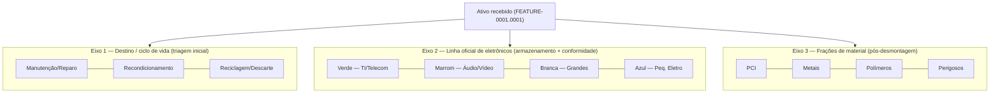

# 📐 Taxonomia de categorias e estrutura de entidades do cadastro de ativos

| Campo | Valor |
|---|---|
| Responde | **PENDENCY-0002** (taxonomia de categorias da B-REQ-01 na Onda 1-Must (MVP mínimo)) — ✅ Respondida em 2026-10-16 · [hub](../../projects/PRJ-SUP-2026-0000-RMR/pendencias.md) |
| B-REQ | **B-REQ-01** (Cadastro Simplificado de Ativos de TI) — [requisitos-negocio](../../projects/PRJ-SUP-2026-0000-RMR/prj-negocio/requisitos/requisitos-negocio.md) |
| Decisão registrada | Estruturar **primeiro as entidades/tabelas** (campos, valores e IDs); MVP inicia pela **Linha Verde** (TI/Telecom), mas as tabelas já nascem aptas às demais frentes |
| Consumido por | **FEATURE-0001.0001** (recebimento — categoria/modelo) · **FEATURE-0001.0003/FEATURE-0001.0004** (cadastros mestres) · **FEATURE-0001.0004/FEATURE-0001.0005/FEATURE-0002.0005** (Identificador Físico do Ativo — §5.1) · **FEATURE-0002.0001** (workflow — status destino) · feature de kits da **Onda 2-Should (MVP completo)** (montagem/desmembramento — §5.3) · **FEATURE-0005.0005** (flag de mídia por modelo) · **FEATURE-0005.0001/FEATURE-0005.0002** (frações pós-desmontagem, Onda 2-Should (MVP completo)) |
| Donos | Suprimentos/TI (categorias/modelos) · Operação (destinos) · Compliance (linhas/frações) |
| Status | 📝 Rascunho (2026-10-16 · §5.1–§5.3 em 2026-10-19) |

## 1. A classificação tem **três eixos**

Todo material que entra é classificado por três eixos **independentes** (um ativo tem: 1 destino + 1 linha + N frações após desmontagem):

## 2. Eixo 1 — `STATUS_DESTINO` (lookup)

| ID | Código | Nome | Descrição | Uso na Onda 1-Must (MVP mínimo) |
|---|---|---|---|---|
| 1 | `MANUTENCAO_REPARO` | Manutenção / Reparo | Defeito corrigível — entra em troca de peças, calibração e testes | ✅ rota teste inicial → reparo (FEATURE-0002.0001) |
| 2 | `RECONDICIONAMENTO` | Recondicionamento (Refurb) | Obsoleto para a corporação, mas funcional — upgrade (RAM/SSD) para doação/revenda | ⬜ seed — rota de reuso/venda vem com F5.x (Onda 2-Should (MVP completo)/Onda 3-Could (Integração & Valor)) |
| 3 | `RECICLAGEM_DESCARTE` | Reciclagem / Descarte final | Sem viabilidade econômica — descaracterização e destruição segura de dados | ✅ rota sucata + travas FEATURE-0005.0005 |

**Campos:** `id` · `codigo` · `nome` · `descricao` · `ordem`.
**Regra:** definido pelo operador na triagem (rota humana — BR-1.1.5) e coerente com a etapa do workflow escolhida (FEATURE-0002.0001).

## 3. Eixo 2 — `LINHA_EEE` + `CATEGORIA_ATIVO` (hierárquica)

### 3.1 `LINHA_EEE` (4 linhas oficiais — armazenamento físico + relatórios de conformidade)

| ID | Código | Nome | Foco de uso |
|---|---|---|---|
| 1 | `VERDE` | Linha Verde — TI e Telecomunicações | ✅ **Onda 1-Must (MVP mínimo)** (foco principal do REEE empresarial) |
| 2 | `MARROM` | Linha Marrom — Eletroeletrônicos de Áudio e Vídeo | ⬜ seed — uso a partir da Onda 2-Should (MVP completo) |
| 3 | `BRANCA` | Linha Branca — Grandes Equipamentos | ⬜ seed — uso a partir da Onda 2-Should (MVP completo) |
| 4 | `AZUL` | Linha Azul — Pequenos Eletrodomésticos | ⬜ seed — uso a partir da Onda 2-Should (MVP completo) |

**Campos:** `id` · `codigo` · `nome` · `cor` · `descricao` · `ativa`.

### 3.2 `CATEGORIA_ATIVO` (categoria → tipo, com autorelação)

**Campos:** `id` · `codigo` · `nome` · `categoria_pai_id` (autorelação) · `linha_id` (FK → LINHA_EEE) · `nivel` (1 = categoria, 2 = tipo) · `caracteristicas` (JSON opcional — atributos que variam por categoria) · `ativa` · `ordem`.

**Seeds — Linha Verde (populados e ativos na Onda 1-Must (MVP mínimo)):**

| Nível | Código | Nome |
|---|---|---|
| 1 | `TI_TELECOM` | Equipamentos de TI e Telecomunicações |
| 2 | `COMP` | Computadores |
| 2 | `NOTE` | Notebooks |
| 2 | `SERV` | Servidores |
| 2 | `ROT` | Roteadores |
| 2 | `SWI` | Switches |
| 2 | `CEL` | Celulares |
| 2 | `TAB` | Tablets |
| 2 | `IMP` | Impressoras |
| 2 | `CAB` | Cabos |
| 2 | `CENTRAL` | Centrais telefônicas |

**Seeds já cadastradas (aptas, fora da Onda 1-Must (MVP mínimo)):** Linha Marrom — monitores (CRT/LCD/LED), televisores, projetores, câmeras de segurança, sistemas de som · Linha Branca — geladeiras, freezers, frigobares, ar-condicionado, micro-ondas · Linha Azul — ventiladores, cafeteiras, aspiradores, trituradores de papel.

## 4. `MODELO` — cadastro de modelos (com a flag LGPD)

**Campos:** `id` · `categoria_id` (FK) · `nome` · `fabricante` · **`possui_midia_armazenamento`** (boolean — base da **BR-5.5.3**, travas FEATURE-0005.0005) · `caracteristicas` (JSON: peso nominal, dimensões, etc.) · `ativo`.

> 💡 O Onda 1-Must (MVP mínimo) nasce com **1 modelo** (fatiamento [escopo da Onda 1-Must (MVP mínimo)](../../projects/PRJ-SUP-2026-0000-RMR/prj-produto/escopo-onda-1.md)); o catálogo completo é da **FEATURE-0001.0003** (Onda 2-Should (MVP completo)). A flag de mídia é **por modelo**, exatamente como decidido no [checklist A4](../../projects/PRJ-SUP-2026-0000-RMR/prj-negocio/requisitos/checklist-juridico-compliance.md).

## 5. `ATIVO` — registro individual

**Campos:** `id` (interno) · **`identificador_unico`** (Identificador Físico do Ativo — ver **§5.1**; obrigatório, indexado, leitura por leitor — BR-1.1.1/BR-1.1.2) · `atributos` (JSONB opcional — atributos de cadastro **não identificadores**: cor, tamanho, família, marca, fabricante, tecnologia, **NDS** (código de importação, quando aplicável) — catálogo por tipo em **§5.2**) · `categoria_id` (FK → tipo) · `modelo_id` (FK) · **`linha_id`** (FK — **derivada da categoria**, gravada para relatórios/conformidade) · `status_destino_id` (FK) · `data_recebimento` · `created_by`.

**Relações:** 1 ativo → 1 categoria, 1 modelo, 1 status destino; 1 ativo → N eventos de workflow (FEATURE-0002.0001) e N frações retiradas (§7); 1 ativo → **0..N kits** ao longo da vida útil, com **no máximo 1 kit ativo** por vez (§5.3).

> ⚠️ O **defeito reclamado** (US-FEAT-0001.0001-0001/US-FEAT-0001.0001-0002) fica no **evento de recebimento**, e o **defeito constatado/OS** no evento de reparo — não em `ATIVO` (que é o cadastro mestre).

### 5.1 Identificador Físico do Ativo — catálogo de tipos

**Conceito (genérico):** o RMR trabalha com o **Identificador Físico do Ativo** — o código **impresso ou presente no dispositivo**. É o campo único de leitura/digitação no recebimento, na triagem e na expedição: o operador bipe/digita **qualquer** código presente no aparelho e o sistema o trata de forma uniforme — validação no cadastro mestre ([FEATURE-0001.0004](../../projects/PRJ-SUP-2026-0000-RMR/prj-produto/features/FEATURE-0001.0004-validacao-identificador-cadastro-mestre.md)), watchlist ([FEATURE-0001.0005](../../projects/PRJ-SUP-2026-0000-RMR/prj-produto/features/FEATURE-0001.0005-watchlist-triagem.md)) e rastreio no pallet ([FEATURE-0002.0005](../../projects/PRJ-SUP-2026-0000-RMR/prj-produto/features/FEATURE-0002.0005-expedicao.md)).

> ⚠️ O **NDS** (código de importação — Anvisa) **não é** o identificador do ativo: ele é um **atributo opcional** de cadastro, preenchido quando aplicável (§5.2).

**Catálogo de tipos** (não exaustivo — cresce por tipo de ativo):

| Tipo | O que é | Tipo de ativo típico |
|---|---|---|
| `SERIAL` (S/N) | Número de série — identifica a peça física do aparelho | Decodificadores de TV, celulares, modems, roteadores |
| `SMART_CARD` | Número do cartão de acesso chipado inserido no aparelho — vincula o plano ao aparelho | Decodificadores de TV por assinatura (cabo/satélite) |
| `SCID` / `SCUAD` | Número de identificação do sistema de acesso condicional | Decodificadores parabólicos (ex.: SAT HD Regional) |
| `CAID` | Identificador do controlador de acesso | Decodificadores parabólicos |
| `CAS` / ID do Receptor | Número exclusivo impresso embaixo do aparelho (ou exibido no "Canal do Cliente") — necessário para ativar canais digitais regionais via satélite | Decodificadores parabólicos |
| `GPON_SN` | Serial do ONT/ONU, comum com prefixo do fabricante (ex.: HUAWEI, NOKIA, ZTE) — principal código usado pela operadora para autorizar o sinal da fibra | Modems de fibra óptica (ONU/ONT) |
| `SAT_KIT_SN` | Serial do roteador, da antena e/ou do kit (antena + decodificador) — identificam cada componente | Internet satelital (ex.: Starlink, HughesNet) |
| `IMEI` | Código global exclusivo de 15 dígitos (o "RG" do celular); aparelhos dual chip possuem 2 IMEIs; obtido discando `*#06#` | Celulares |
| `ICCID` | 19–20 dígitos, impresso no próprio cartão SIM (atrás do chip) e no cartão grande de onde é destacado | Chips SIM |
| `IMSI` | Código interno gravado dentro do chip que identifica o usuário na rede global de telefonia (não fica impresso por fora) | Chips SIM |

**Regras de uso:**

- **Um ativo pode expor mais de um código** (ex.: decodificador parabólico com S/N + SCID/CAID/CAS; celular dual chip com 2 IMEIs). O `identificador_unico` da `ATIVO` guarda o identificador usado como **chave de rastreio**; os demais, quando necessários à operação, ficam registrados junto ao item (ex.: smart card auditado na embalagem — [FEATURE-0002.0001](../../projects/PRJ-SUP-2026-0000-RMR/prj-produto/features/FEATURE-0002.0001-painel-kanban-workflow.md)). Quando o smart card é um **cartão físico separado**, ele é um **ativo próprio** que compõe um kit (§5.3).
- **A lista é extensiva e configurável:** novos tipos de identificador entram como seed/configuração (dicionário de termos/aliases — [domain.md §4](../tecnico/domain.md)), **sem mudança de estrutura**.
- **Lei de formação por tipo/modelo:** o formato esperado de cada identificador é configurado por modelo/categoria de ativo — em divergência, **a regra específica do modelo/tipo/família vence a genérica** (decisão 2026-10-21 — [PENDENCY-0012](../../projects/PRJ-SUP-2026-0000-RMR/pendencias.md) item 3). As **regras documentadas** (regex, larguras, higienização, cross-validações, NDS) estão em **[regras-formacao-identificadores.md](regras-formacao-identificadores.md)**. O **mapeamento MODELO → identificadores (e identificador primário)** está definido no **§5.1.1** (tabelas `TIPO_IDENTIFICADOR` + `MODELO_IDENTIFICADOR` — DDL no rolling wave da FEATURE-0001.0003).
- **`MAC_ADDRESS` não é identificador nem atributo:** é **exigência de cross-validation** — campo obrigatório exigido na leitura/importação de certos tipos (GPON/roteador), validado por regex de MAC, sem ser parte do catálogo §5.1 nem do cadastro §5.2 (decisão 2026-10-21 — [PENDENCY-0012](../../projects/PRJ-SUP-2026-0000-RMR/pendencias.md) item 5).

### 5.1.1 Mapeamento MODELO → identificadores (ponte — decisão ✅ [PENDENCY-0012](../../projects/PRJ-SUP-2026-0000-RMR/pendencias.md), 2026-10-21)

**Conceito:** o catálogo §5.1 define os **tipos** de identificador; a lei de formação é aplicada **por modelo** (a regra específica do modelo/tipo/família **vence** a genérica — item 3). A ponte entre `MODELO` e os identificadores que ele herda/valida é feita por **duas tabelas** (DDL no rolling wave da **FEATURE-0001.0003** — **fora da Onda 1-Must (MVP mínimo)**, sem impacto no ENABLER-0005):

- **`TIPO_IDENTIFICADOR`** (seed do catálogo §5.1): `id` · `codigo` (`SERIAL`, `SMART_CARD`, `SCID`, `CAID`, `CAS`, `GPON_SN`, `SAT_KIT_SN`, `IMEI`, `ICCID`, `IMSI`) · `nome` · `regex` · `tamanho_min` · `tamanho_max` · `higienizacao` (JSON — pré-validações: caixa alta, limpeza de rótulos) · `cross_validations` (JSON — **exigências por tipo**, ex.: `GPON_SN` exige `MAC_ADDRESS`; celular exige IMEI com Luhn; decodificador exige `SMART_CARD`) · `ativa`.
- **`MODELO_IDENTIFICADOR`** (ponte modelo ↔ identificadores): `modelo_id` (FK) · `tipo_identificador_id` (FK) · `obrigatorio` (boolean) · **`primario`** (boolean — **exatamente 1 por modelo**) · `regex_override` (opcional — sobrescreve a regex/tamanho do tipo, atendendo à precedência "modelo vence genérico").

**Regras:**

1. **Herança:** um `MODELO` herda da sua `CATEGORIA_ATIVO` (nivel 2) o conjunto **padrão** de identificadores do tipo; o cadastro do modelo pode ajustar via `regex_override`/`obrigatorio`.
2. **Primário:** o identificador marcado como `primario` no modelo é o formato validado em **`ATIVO.identificador_unico`**.
3. **Exemplos:** decodificador → `SERIAL` (primário, 10–14) + `SMART_CARD` (obrigatório, regex de 12 dígitos) · celular → `SERIAL` (primário, 10–12) + `IMEI` (obrigatório, cross-validation Luhn) · modem de fibra → `GPON_SN` (primário, regex 12/16 + whitelist) + **exigência** de `MAC_ADDRESS` (cross-validation, §5.1).
4. **Extensível:** novos tipos entram como seed/configuração — **sem mudança de estrutura** (mesmo princípio do catálogo §5.1).
- No Onda 1-Must (MVP mínimo), a leitura aceita **qualquer** tipo de identificador presente no dispositivo — o campo nasce genérico.

### 5.2 Atributos de cadastro (não identificadores)

Além do identificador, um ativo pode ter **outros atributos vinculados ao cadastro que não servem de identificação**: **cor, tamanho, modelo/família, marca, fabricante, tecnologia** etc. **Cada tipo/classe de ativo pode ter atributos específicos** — o conjunto aplicável é definido pela categoria/tipo (`caracteristicas` da `CATEGORIA_ATIVO` — §3.2) e os valores ficam no ativo (`ATIVO.atributos`, JSONB).

- **NDS** é um desses atributos: identifica o **código de importação** do ativo (contexto Brasil — sistema da Anvisa, de controle e licenciamento de importações; encontrado em documento de importação/fiscal de produto eletrônico que entra no país). É **opcional** — preenchido **quando aplicável** (ativos importados).
- **Lista aberta:** novos atributos por tipo de ativo entram como configuração (JSON), **sem mudança de estrutura**.

### 5.3 `KIT` — composição de ativos (conjunto/pacote)

**Conceito:** **vários ativos podem montar/envolver/definir um kit** (package). Exemplos:

- **Kit de ativação de TV por Assinatura:** 1 decodificador de TV por assinatura (cabo/satélite) + 1 smart card físico/externo — alguns decodificadores necessitam do smart card para ativar a liberação de sinal.
- **Kit satelital:** 1 antena satelital + 1 modem satelital + 1 amplificador de sinal satelital.

**Entidades:**

- **`KIT`:** `id` · `tipo_kit` (código configurável — ex.: `KIT_ATIVACAO_TV`, `KIT_SATELITAL`) · `status` (`ATIVO` / `DISMEMBRADO`) · `data_criacao` · `created_by`.
- **`KIT_ITEM`:** `id` · `kit_id` (FK) · `ativo_id` (FK) · `papel` (função no kit — ex.: decodificador, smart card, antena, modem, amplificador) · `data_entrada` · `data_saida` (preenchida no desmembramento de kit) · `motivo_saida`.

**Regras:**

1. **Ativos podem ou não compor kits** — pertencer a um kit **não é obrigatório**.
2. **Um ativo pode fazer parte de vários kits ao longo da sua vida útil**, mas **somente 1 kit pode estar `ATIVO`** para um ativo por vez (índice único parcial em `KIT_ITEM.ativo_id` para kit ativo).
3. **Desmembramento de kit:** um kit pode ser desmembrado quando um dos ativos for direcionado a **manutenção/reparo** — o item sai do kit (`data_saida` + `motivo_saida`) e o kit vai para `DISMEMBRADO`.
4. **Montagem/recomposição:** um kit pode ser criado/recomposto com ativos **provenientes de manutenção/reparo** (ex.: decodificador reparado + smart card reutilizado → novo kit ativo). A **montagem de kits** e o **desmembramento de kits** são implementados **juntos** (mesma feature).

**Fase (decisão ✅ [PENDENCY-0017](../../projects/PRJ-SUP-2026-0000-RMR/pendencias.md) — 2026-10-19):** na Onda 1-Must (MVP mínimo) **só a estrutura** — as tabelas existem e recebem dados, mas o workflow **não consulta kits**. **Montagem de kits** e **desmembramento de kits** vêm **juntos** na **feature de kits (Onda 2-Should (MVP completo))**, a criar no backlog no rolling wave.

## 6. Eixo 3 — `FRACAO_MATERIAL` (pós-desmontagem — FEATURE-0005.0001/FEATURE-0005.0002, Onda 2-Should (MVP completo))

**Campos:** `id` · `codigo` · `nome` · `grupo` (PCI / METAL / POLIMERO / PERIGOSO) · `perigoso` (boolean) · `unidade` (kg) · `ativa`.

| Grupo | Seeds |
|---|---|
| `PCI` | Placa alta amostragem (celular/processador/memória — ouro, prata) · Placa média (placas-mãe PC/servidor) · Placa baixa (fontes, monitores antigos, impressoras) |
| `METAL` | Ferro/Aço (gabinetes, carcaças, racks) · Alumínio (dissipadores, perfis) · Cobre (fios, cabos de rede/força) |
| `POLIMERO` | ABS/PC (carcaças, teclados, mouses, impressoras → moagem/extrusão) |
| `PERIGOSO` | Baterias/pilhas (íon-lítio, chumbo-ácido, NiCd) · Telas e vidros (LCD/LED, CRT — mercúrio/chumbo) |

## 7. `FRACAO_RETIRADA` — rastreio da desmontagem (peso)

**Campos:** `id` · `ativo_id` **ou** `lote_id` · `fracao_id` (FK) · `peso_kg` · `data_hora` · `operador` · `destino` (venda/destinação certificada).

> Estrutura **pronta desde a Onda 1-Must (MVP mínimo)** (a tabela existe e recebe os dados), mas o **uso** começa com o desmanche/estoque (FEATURE-0005.0001/FEATURE-0005.0002 — Onda 2-Should (MVP completo)) e a **balança integrada** é pendência (PENDENCY-0011).

## 8. Requisitos de sistema citados — situação

| Requisito | Situação |
|---|---|
| **Rastreio por número de série** (destruição de dados HD/SSD) | ✅ **No Onda 1-Must (MVP mínimo)** — `identificador_unico` + trava FEATURE-0005.0005 (US-FEAT-0005.0005-0011) |
| **Balança integrada** (peso de entrada e de frações) | ⬜ **PENDENCY-0011** — fora da Onda 1-Must (MVP mínimo); estrutura `FRACAO_RETIRADA` já prevista |
| **Emissão de MTR** | ✅ **No Onda 1-Must (MVP mínimo): registro manual do nº** (decidido no [checklist B1](../../projects/PRJ-SUP-2026-0000-RMR/prj-negocio/requisitos/checklist-juridico-compliance.md)); integração = evolução |
| **Emissão de CDF** (Certificado de Destinação Final) | ⬜ **PENDENCY-0010** — novo; fora da Onda 1-Must (MVP mínimo), acompanha a integração de MTR pós-Onda 1-Must (MVP mínimo) |

## 9. Prontidão MVP × demais fases

| Entidade/seed | No Onda 1-Must (MVP mínimo) | Pronta para depois |
|---|---|---|
| `LINHA_EEE` | 4 linhas cadastradas; uso = Verde | Marrom/Branca/Azul ganham uso na Onda 2-Should (MVP completo) |
| `CATEGORIA_ATIVO` | Verde completa (10 tipos) | Demais linhas já com seeds, `ativa=false` de uso |
| `MODELO` | 1 modelo + flag de mídia | Catálogo completo (FEATURE-0001.0003) |
| `TIPO_IDENTIFICADOR` + `MODELO_IDENTIFICADOR` | fora da Onda 1-Must (MVP mínimo) — DDL no rolling wave (FEATURE-0001.0003, Onda 2-Should (MVP completo)) | Lei de formação dos identificadores por modelo — **PENDENCY-0012** ✅ (§5.1.1) |
| `STATUS_DESTINO` | usa Manutenção + Reciclagem | Recondicionamento ativa com reuso/venda (F5.x) |
| `FRACAO_MATERIAL` + `FRACAO_RETIRADA` | tabela pronta, sem uso | Desmanche/estoque (FEATURE-0005.0001/FEATURE-0005.0002) + balança (PENDENCY-0011) |
| `ATIVO` | completo (FEATURE-0001.0001) | — |
| `KIT` + `KIT_ITEM` | tabelas prontas (sem DDL futuro) | Feature de kits (Onda 2-Should (MVP completo)): **montagem** + **desmembramento** · Onda 1-Must (MVP mínimo) = só estrutura (**PENDENCY-0017** ✅) |

## 10. Critérios de aceite (definition of done)

- [ ] As **9 entidades** existem no banco com os campos e FKs acima e seeds populados (4 linhas, 11 categorias/tipos, 3 destinos, frações, KIT/KIT_ITEM).
- [ ] Todo ativo recebido na Onda 1-Must (MVP mínimo) tem `categoria_id` (tipo da Linha Verde) + `modelo_id` + `status_destino_id` + `linha_id` derivada.
- [ ] Um ativo figura em **no máximo 1 kit `ATIVO`** por vez (índice único parcial — §5.3).
- [ ] A flag `possui_midia_armazenamento` do modelo alimenta diretamente a BR-5.5.3 (travas FEATURE-0005.0005).
- [ ] Cadastrar categoria/tipo de **qualquer** linha não exige mudança de estrutura (só seed).
- [ ] `FRACAO_RETIRADA` recebe peso por fração quando o desmanche (Onda 2-Should (MVP completo)) abrir — sem DDL novo.
