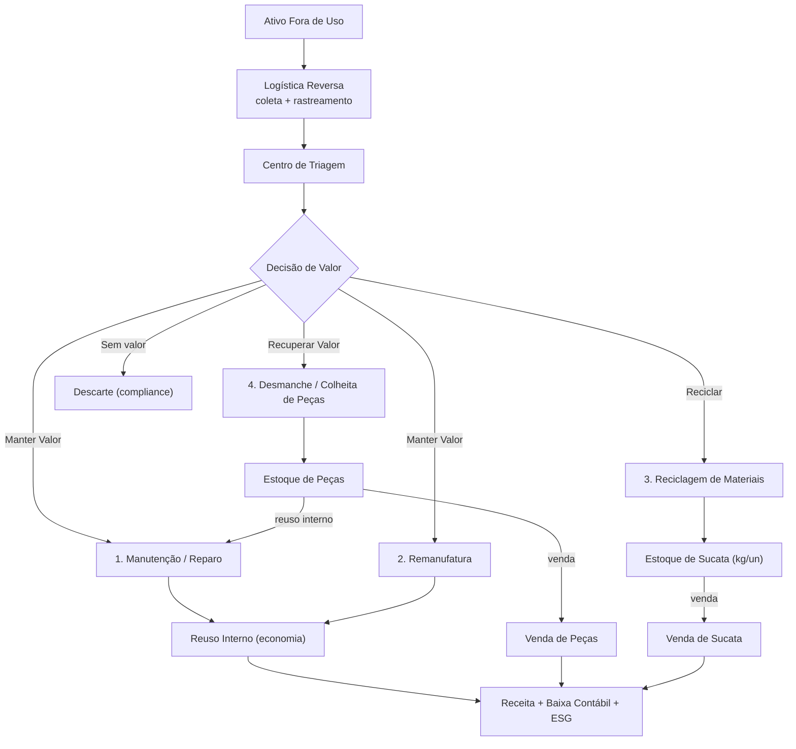

# 👁️ Visão do Produto — RMR by FBSO

> **Produto:** RMR Reversa — Sistema de Reparo, Manutenção e Reciclagem de Ativos com Economia Circular via Logística Reversa.
> RMR Tech (Reparo, Manutenção e Reciclagem Tecnologia)

## 1. Direcionamento do Board (por quê fazemos)

- **Contexto:** o Board aprovou a criação de um sistema interno de reciclagem e reparo de ativos para mitigar o aumento de custos de CapEx e apoiar as metas de sustentabilidade.
- **Objetivo de negócio:** reduzir em 30% a compra de novos equipamentos no primeiro ano.

## 2. O que é o produto

Uma plataforma interna que tria equipamentos quebrados ou substituídos, direciona para a oficina interna e disponibiliza os itens consertados para reuso antes de novas compras.

### 2.1. Benefícios empresariais e regulatórios

> 💡 Tabela de benefícios em [beneficios-esperados.md](beneficios-esperados.md) — dimensões Financeira, Operacional, Legal/Compliance (PNRS) e Reputação (ESG).

### 2.2. Ciclo do processo (com recuperação de valor)

O ciclo reverso ganha um **novo eixo de recuperação de valor**: além de manter valor (reparo/remanufatura) e reciclar, o ativo pode ser **desmontado para colheita de peças**, e o que não é reutilizável é vendido como **sucata** — tudo para **minimizar o prejuízo** da quebra.

| Saída | Natureza | Unidade | Destino |
|---|---|---|---|
| **Peças** (usada testada / recondicionada) | SKU + condição + garantia | unidade | Reuso interno **ou** venda |
| **Sucata** (material) | material + classe ambiental | **kg / un (UoM)** | Venda a recicladores |

> 💡 **Métrica do Board:** `Prejuízo líquido = valor do ativo − (reuso evitado + receita de peças + receita de sucata) + custos`. A **Taxa de Recuperação de Valor** mede o quanto do ativo foi monetizado.

## Estrutura deste produto

| Onde | O que |
|---|---|
| [docs/](../README.md) | Definição persistente do produto (negócio, produto, técnico) |
| [projects/](../../projects) | Projetos de evolução (um por entrega) |
