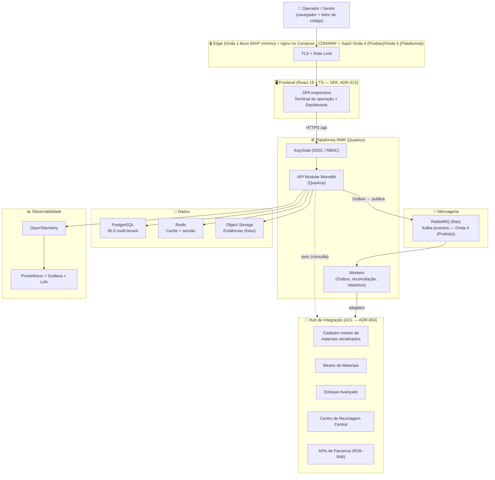

# 🏗️ architecture.md — arquivo principal de arquitetura da solução

| Campo | Valor |
|---|---|
| **Projeto** | PRJ-SUP-2026-0000-RMR · Plataforma de Ciclo de Vida de Materiais (Reparo, Manutenção e Reciclagem) |
| **Arquitetura global** | **Monólito modular** (Quarkus — [ADR-012](adrs/adr-012-stack-onda-1.md)) event-driven, multi-tenant |
| **Stack** | Java 25 + Quarkus (Mandrel) · React 19 + **Vite + TanStack Router/Query (SPA — [ADR-013](adrs/adr-013-frontend-spa.md))** · PostgreSQL 17 (RLS) · Flyway · Keycloak · RabbitMQ/Kafka · Redis (SaaS) · K8s/Istio/KEDA — **Onda 1-Must (MVP mínimo) inteira em Docker Compose (servidor interno)**; DOKS/Kong/Istio/Redis = SaaS Onda 4 (Produto)/Onda 5 (Plataforma) |
| **Insumos** | [PEDIDO](../../../projects/PRJ-SUP-2026-0000-RMR/prj-negocio/discovery/PEDIDO.md) (R1–R59) · [BRAINSTORM](../../../projects/PRJ-SUP-2026-0000-RMR/prj-produto/discovery/BRAINSTORM.md) (Premissas 1–5) |
| **Status** | 📝 **PROPOSTA** — projeto em ideação (não confundir com COMPLIANCE) · v1 em 2026-10-21 |

> **Sobre esta estrutura:** o documento SAD único do fluxo waterfall (05-SAD) foi **dissolvido em arquivos por necessidade** — C4, ADRs, dados, integrações, segurança, engenharia (ver §5). Este arquivo é o **ponto de entrada**: visão geral + navegação.

---

## 1. Estilo arquitetural

**Monólito modular** (Quarkus — ADR-012) com **arquitetura hexagonal** por módulo, comunicação assíncrona orientada a eventos (Outbox) e integração por **adaptadores (Anti-Corruption Layer — ADR-004)**. **Não** iniciamos com microserviços: os módulos têm fronteiras explícitas e podem ser extraídos quando houver necessidade comprovada (ADR-001).

## 2. Visão geral

> **Onda 1-Must (MVP mínimo) (ADR-012):** a Onda 1-Must (MVP mínimo) inteira (dev, homolog, prod) roda em **Docker Compose no servidor interno** — zero dependências externas; CDN/WAF, Kafka, Redis e K8s/Istio/KEDA ficam como alvo SaaS (Onda 4 (Produto)/Onda 5 (Plataforma)).

## 3. Regras de ouro da arquitetura modular

1. **Domínio não conhece sistemas externos** — os módulos dependem de portas; os sistemas de referência vivem em `integration` (adaptadores/ACL — [ADR-004](adrs/adr-004-acl-outbox.md)).
2. **Workflow é o orquestrador** — as etapas chamam o motor, nunca o inverso.
3. **`catalog` e `serialized-asset` são a fonte da verdade** do que é material (SKU) e material serializado (unidade).
4. **`tenancy` é transversal** — toda configuração (workflow, catálogos, etiquetas, dicionário, política de evidência) é resolvida por tenant.
5. **Toda movimentação gera evento** (`StageTransition`) — base de auditoria, dashboards e integrações.

## 4. Navegação — mapa dos documentos de arquitetura

| Documento | Arquivo | Conteúdo | Status |
|---|---|---|---|
| **Este arquivo** | [architecture.md](architecture.md) | Visão geral + navegação (ponto de entrada) | ✅ v1 (2026-10-21) |
| C4 | [c4-context.md](c4-context.md) · [c4-containers.md](c4-containers.md) · [c4-components.md](c4-components.md) · [c4-code-class.md](c4-code-class.md) | Níveis 1–4 do modelo C4 | ✅ v1 (2026-10-21) |
| ADRs | [adrs/INDEX.md](adrs/INDEX.md) | Registro de decisões 001–014 (um arquivo por decisão) | ✅ 14/14 (2026-10-21) |
| Integrações | [integracoes/integrations.md](integracoes/integrations.md) | Hub de integrações + contrato OpenAPI por sistema | ✅ 1/5 (cadastro mestre) |
| Dados | [mer.md](mer.md) · [erd.md](erd.md) · [data-dictionary.md](data-dictionary.md) · [datamapping.md](datamapping.md) | Modelo relacional, diagrama, dicionário, mapeamento externo | ✅ v1 (2026-10-21) |
| Engenharia | [devops.md](devops.md) · [testing.md](testing.md) · [cloud.md](cloud.md) · [infrastructure.md](infrastructure.md) | CI/CD, testes, cloud, infraestrutura | ✅ v1 (2026-10-21) |
| Segurança | [../seguranca/SECURITY.md](../seguranca/SECURITY.md) | Auth/Keycloak, RLS, STRIDE, auditoria, LGPD-técnico | ✅ v1 (2026-10-21) |
| Diretrizes | [diretrizes-arquitetura.md](https://github.com/fbso-techservice/platform/blob/main/standards/architecture/diretrizes-arquitetura.md) | API-First, `tenant_id`, SSO, APIs REST abertas | ✅ |
| Gate da Onda 1-Must (MVP mínimo) | [checklist-arquitetura-onda-1.md](../../../projects/PRJ-SUP-2026-0000-RMR/prj-tecnico/checklist-arquitetura-onda-1.md) | 9 decisões do gate (PENDENCY-0015) | ✅ 9/9 (2026-10-19) |
| Domínio / Inventário | [../domain.md](../domain.md) · [../inventory.md](../inventory.md) | Bounded contexts · soluções sistêmicas envolvidas | ✅ v1 (2026-10-21) |

## 5. Onde vive cada coisa (dissolução do 00 Overview · 05 SAD · 06 HLD)

| Conteúdo dos waterfall (00 Overview · 05 SAD · 06 HLD) | Documento atual |
|---|---|
| 00 Architecture Overview | **architecture.md** (este) §1–§2 + [c4-context.md](c4-context.md) |
| 06 HLD — diagramas de alto nível | **architecture.md** §2 + [c4-containers.md](c4-containers.md) |
| §1 Architectural Overview + ADR Registry | **architecture.md** (este) + [adrs/INDEX.md](adrs/INDEX.md) |
| §2 Solution Architecture (módulos, hexagonal) | [../domain.md](../domain.md) + [c4-components.md](c4-components.md) |
| §3 Data Architecture (ER, dois níveis) | [mer.md](mer.md) + [erd.md](erd.md) + [data-dictionary.md](data-dictionary.md) + [datamapping.md](datamapping.md) |
| §4 Security & Multi-Tenancy + STRIDE | [../seguranca/SECURITY.md](../seguranca/SECURITY.md) |
| §5 Integration Architecture (ACL, hub) | [integracoes/integrations.md](integracoes/integrations.md) + [adrs/adr-004-acl-outbox.md](adrs/adr-004-acl-outbox.md) |
| §6 Configurability Architecture | [../domain.md](../domain.md) (config por tenant) |
| §7 DevOps / SRE | [devops.md](devops.md) |
| §8 Infrastructure / Cloud | [infrastructure.md](infrastructure.md) + [cloud.md](cloud.md) |
| §9 Testing Architecture | [testing.md](testing.md) |
| §10 Cross-cutting + §11 Traceability | [testing.md](testing.md) + [adrs/INDEX.md](adrs/INDEX.md) (rastreio) |

## 6. Sob demanda — o que ainda não foi criado

A reconstrução seguiu o critério **um documento por necessidade**: nada foi recriado sem demanda ativa. Ficam registrados abaixo (**texto sem link** — o link nasce junto com o arquivo):

| Item | Quando nasce | Gatilho |
|---|---|---|
| LLDs de feature — workflow instância/transição/não serializado, evidência, triagem, labeling (07.1–07.4, 07.10–07.12) | dev da feature correspondente | feature iniciada na sprint |
| Integrações 2–5 (materiais/estoque · centro de reciclagem · parceiros · mensageria/reconciliação) | quando a entrega iniciar | [integrations §1](integracoes/integrations.md) — linhas `⏳` |
| LLD do motor de recuperação de valor | definição de produto do módulo | [ADR-011](adrs/adr-011-motor-recuperacao-valor.md) |

> **Régua:** primeiro a necessidade, depois o arquivo — **nenhum documento vivo aponta para arquivo inexistente** (verificado por link-checker a cada commit). Pendências de negócio seguem no [hub](../../../projects/PRJ-SUP-2026-0000-RMR/pendencias.md).
