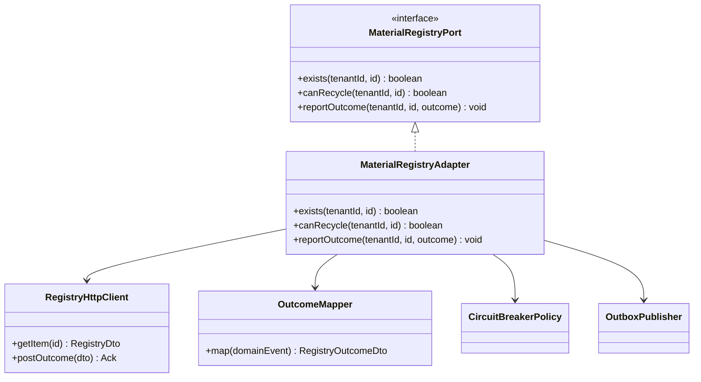

# C4 — Nível 4: Código (classes)

| Campo | Valor |
|---|---|
| **Papel** | Detalhe de **classes/interfaces** das partes mais críticas — nível seletivo, **cresce junto com o código** (não inventa classe que ainda não existe) |
| **Fonte** | [integracoes/integracao-cadastro-mestre.md](integracoes/integracao-cadastro-mestre.md) §3 (ACL) · entidades de [mer.md](mer.md) · dissolvido do SAD |
| **Status** | ✅ v1 (2026-10-21) — 🟡 **parcial**: cresce com a implementação (Sprint 1+) |

## 1. Integração — ACL do cadastro mestre (ADR-004)



**Convenções:** nenhum termo proprietário do sistema externo passa daqui para o domínio; `RegistryDto`/`RegistryOutcomeDto` são os únicos modelos externos aceitos pelo adaptador; devolutiva sai sempre pelo `OutboxPublisher` com `idempotency_key` (BR-1.4.7).

## 2. Núcleo de domínio — entidades-chave

```mermaid
classDiagram
    class Material {
        <<entity>>
        +material_id UUID PK
        +tenant_id UUID FK
        +codigo String
        +tipo String "serializado|nao_serializado"
        +regra_formacao JSONB
    }
    class MaterialSerializado {
        <<entity>>
        +unidade_id UUID PK
        +tenant_id UUID FK
        +material_id UUID FK
        +tracking_code String
        +external_ids JSONB
        +estagio_atual String
    }
    class WorkflowDef {
        <<entity>>
        +def_id UUID PK
        +tenant_id UUID FK
        +estagios JSONB
        +transicoes JSONB
    }
    class StageTransition {
        <<entity>>
        +transicao_id UUID PK
        +unidade_id UUID FK
        +de_estagio String
        +para_estagio String
        +ocorrido_em timestamptz
    }
    class WorkflowEngine {
        <<service>>
        +fire(unidadeId, evento) StageTransition
        +preCondicoes(unidadeId, transicao) boolean
    }

    Material ||--o{ MaterialSerializado : instancia
    MaterialSerializado ||--o{ StageTransition : movimenta
    WorkflowDef ||--o{ StageTransition : "valida"
    WorkflowEngine --> WorkflowDef
    WorkflowEngine --> StageTransition
```

> O **workflow é orquestrador** (regra de ouro #2): `WorkflowEngine` só é chamado pelas etapas, nunca chama etapas. Tipos e chaves completos: [mer.md](mer.md) · [erd.md](erd.md).

## 3. Regras para crescer este documento

1. Só entra aqui classe **efetivamente prevista/implementada** — spec não vira diagrama antes de virar código.
2. Cada feature que nasce código de risco (workflow, integração, segurança) adiciona seu recorte.
3. Nível 4 é **seletivo**: a referência completa é o próprio repositório — este doc documenta as decisões de desenho, não toda a árvore.
