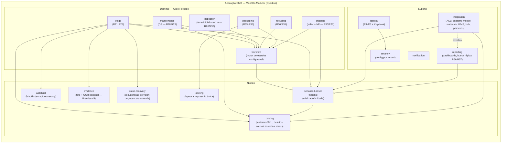

# C4 — Nível 3: Componentes

| Campo | Valor |
|---|---|
| **Papel** | Módulos internos do contêiner **API** (monólito modular) — fronteiras explícitas de domínio |
| **Fonte** | dissolvido do SAD §2 · regras de ouro em [architecture.md](architecture.md) §3 · domínio em [../domain.md](../domain.md) |
| **Status** | ✅ v1 (2026-10-21) |

## Módulos e responsabilidades

| Módulo | Responsabilidade | Requisitos |
|---|---|---|
| `identity` | Usuários, perfis, telas, login único, política de senha/reset | R1–R5 |
| `catalog` | Materiais (SKU), defeitos, local danificado, causa raiz, serviços, sem conserto, insumos/BOM, níveis de reparo | R6–R16, R18 |
| `serialized-asset` | Material serializado (unidade), `trackingCode`, identificadores externos, lei de formação | R15, R21, R17 |
| `workflow` | Definição/instância de workflow, estágios, transições, pré-condições, permissões | R20, R14 |
| `triage` | Identificação, validação, blacklist/scrap/boomerang, etiqueta, destino | R21–R25, R19, R23 |
| `inspection` | Teste inicial e run in | R26, R27, R32 |
| `maintenance` | Ordem de serviço (técnico, tempos, defeito, componente, causa, serviço) | R28, R29 |
| `recycling` | Serviço cosmético e operador | R30, R31 |
| `packaging` | Embalagem, smart card, etiqueta final | R33–R35 |
| `shipping` | Pallet ID e expedição (NF) | R36, R37 |
| `labeling` | Layouts e controle de impressão única/reimpressão | R58, R59 |
| `evidence` | Captura de foto + OCR opcional (configurável) | Premissa 5 |
| `watchlist` | Blacklist, scrap, boomerang | R19, R23 |
| `value-recovery` | Motor de recuperação de valor; estoques de peças/sucata; venda (RMR Market) | B-REQ-09/10, Premissa 7 |
| `integration` | Adapters + idempotência + validação (lei de formação) + reconciliação | R38–R48, R46 |
| `reporting` | Dashboards, relatórios, busca rápida | R49–R57 |
| `notification` | Notificações (reset de senha, alertas) | R5 |
| `tenancy` | Tenants, aliases, feature flags, configuração | Premissa 1, §6.6 |

> Componentes do módulo `integration` (portas/adaptadores) com seus diagramas de sequência: [integracoes/integracao-cadastro-mestre.md](integracoes/integracao-cadastro-mestre.md) · [ADR-004](adrs/adr-004-acl-outbox.md).
