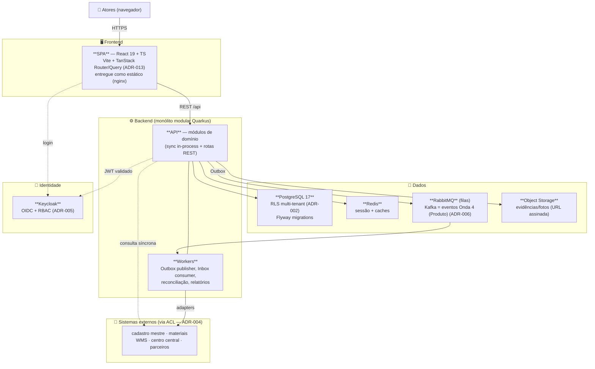

# C4 — Nível 2: Contêineres

| Campo | Valor |
|---|---|
| **Papel** | Os contêineres (aplicações/dados em processos separados) que compõem o Sistema RMR e suas responsabilidades |
| **Fonte** | [architecture.md](architecture.md) §2 · decisões [ADR-012](adrs/adr-012-stack-onda-1.md) e [ADR-013](adrs/adr-013-frontend-spa.md) |
| **Status** | ✅ v1 (2026-10-21) |

| Contêiner | Responsabilidade | Stack / decisão | Nota da Onda 1-Must (MVP mínimo) |
|---|---|---|---|
| **SPA** | Terminal de operação + dashboards — keyboard-first, responsiva | React 19, Vite, TanStack Router/Query ([ADR-013](adrs/adr-013-frontend-spa.md)) | build estático no Compose |
| **API** | Módulos de domínio (ver [c4-components.md](c4-components.md)); hexagonal por módulo | Java 25 + Quarkus (Mandrel) | mesmo container Compose |
| **Workers** | Outbox/Inbox, reconciliação, relatórios pesados | mesmo código (Quarkus) | processo no Compose |
| **PostgreSQL** | Fonte da verdade; RLS por `tenant_id`; migrations | PostgreSQL 17 + Flyway ([ADR-002](adrs/adr-002-rls-multi-tenant.md)) | volume no Compose |
| **RabbitMQ** | Filas de integração/eventos | RabbitMQ (Kafka = Onda 4 (Produto) — [ADR-006](adrs/adr-006-rabbitmq-kafka.md)) | no Compose |
| **Redis** | Sessão e caches de leitura | Redis | no Compose |
| **Object Storage** | Evidências (metadados no PG, binário aqui) | MinIO/S3 compatível ([ADR-007](adrs/adr-007-evidencia-configuravel.md)) | no Compose |
| **Keycloak** | IdP único — realms front/backend | Keycloak auto-hospedado ([ADR-005](adrs/adr-005-keycloak-oidc.md)) | no Compose |
| **nginx** | Edge da Onda 1-Must (MVP mínimo) (TLS, rate limit, estático) | nginx | no Compose |

> **Onda 1-Must (MVP mínimo) (ADR-012):** todos os contêineres rodam em **Docker Compose no servidor interno** (zero dependências externas). K8s/Istio/KEDA + DOKS/Kong/Redis gerenciado = alvo **SaaS Onda 4 (Produto)/Onda 5 (Plataforma)** — ver [infrastructure.md](infrastructure.md) e [cloud.md](cloud.md).
