# C4 — Nível 1: Contexto do sistema

| Campo | Valor |
|---|---|
| **Papel** | Onde o **Sistema RMR** se encaixa no mundo: atores que usam e sistemas externos que conversam com ele |
| **Fonte** | [architecture.md](architecture.md) §2 · domínio detalhado em [../domain.md](../domain.md) |
| **Status** | ✅ v1 (2026-10-21) |

```mermaid
flowchart LR
    subgraph People["👥 Atores"]
        OP["👤 Operador de oficina\n(leitor de código + teclado)"]
        GS["👤 Gestor / Suprimentos\n(dashboards, decisão de rota)"]
        ADM["👤 Admin / TI\n(config por tenant)"]
    end

    RMR["🛰️ **Sistema RMR**\nReparo, Manutenção e Reciclagem\n(cadastro, triagem, workflow, evidência, expedição)"]

    subgraph Ext["🏢 Sistemas externos"]
        CM["Sistema de **Cadastro Mestre**\nde materiais serializados\n(SAP/TOTVS/Senior/Sankhya/interno)"]
        MM["**Mestre de Materiais**\n(SKU)"]
        WMS["**WMS/EWM** — Estoque\navançado"]
        CRC["**Centro de Reciclagem**\nCentral (logística)"]
        PRT["**APIs de Parceiros**\n(linha, laboratório, expedição)"]
        KC["**Keycloak** (IdP)\nOIDC / RBAC"]
        NDS["**Sistema NDS / Anvisa**\n(fonte do atributo NDS)"]
    end

    OP --> RMR
    GS --> RMR
    ADM --> RMR
    RMR <-->|"consulta + devolutiva (R17/R22/R48)"| CM
    RMR <-->|"consulta/atualização (R47)"| MM
    RMR <-->|"buscar/receber/devolver (R47)"| WMS
    RMR <-->|"controle logístico (R38)"| CRC
    RMR -->|"entrada (R39–R46)"| PRT
    RMR -.->|"autenticação (OIDC)"| KC
    NDS -.->|"origem do NDS (portal/peticionamento)"| RMR
```

| Referência | Papel no contexto | Doc |
|---|---|---|
| Sistema de cadastro mestre | Consulta de elegibilidade + recebimento de desfecho | [integracoes/integracao-cadastro-mestre.md](integracoes/integracao-cadastro-mestre.md) |
| Mestre de materiais · WMS · Centro central · Parceiros | Integrações R47/R38/R39–R46 | [integracoes/integrations.md](integracoes/integrations.md) |
| Keycloak | IdP único (ADR-005) | [../seguranca/README.md](../seguranca/README.md) |
| Sistema NDS/Anvisa | Origem do **atributo opcional NDS** (não é integração API — fonte documental da AI) | [regras-formacao-identificadores §6](../../negocio/regras-formacao-identificadores.md) |
