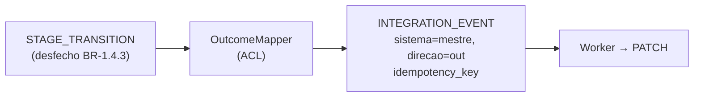

# 🔀 datamapping — mapeamento de dados com sistemas externos

| Campo | Valor |
|---|---|
| **Papel** — O QUE vira O QUE | Payload de cada sistema ↔ colunas do RMR: transformações, chaves de match e pendências. **Hub das integrações:** [integracoes/integrations.md](integracoes/integrations.md) · **modelo alvo:** [mer.md](mer.md) · [data-dictionary.md](data-dictionary.md) |
| **Fonte** | [OpenAPI do cadastro mestre](integracoes/contratos/openapi-cadastro-mestre.yaml) · [regras-formacao-identificadores](../../negocio/regras-formacao-identificadores.md) (higienização/cross-validações) · [taxonomia](../../negocio/taxonomia-entidades-cadastro-ativos.md) · SAD §5 (dissolvido) |
| **Status** | 📝 **v1 parcial** — item 1 (cadastro mestre) especificado; itens 2–5 criam quando a entrega iniciar |

---

## 1. Visão geral — integração × tabelas-alvo

| # | Integração | Direção | Match/chave | Tabelas-alvo | Status |
|---|---|---|---|---|---|
| 1 | **Cadastro mestre** (serializados) | `out` consulta · `out` devolutiva | `identifierType` + `identifierValue` → `ATIVO.identificador_unico` | `ATIVO` · `INTEGRATION_EVENT` · `STAGE_TRANSITION` (origem do desfecho) | ✅ especificado (§2–§3) |
| 2 | Mestre de materiais (SKU) | `out` consulta/atualização | código do material → `MODELO` | `MODELO` · `CATEGORIA_ATIVO` | ⏳ doc futuro |
| 3 | WMS/EWM (estoque) | `out` escrita/leitura | unidade/qty → `APONTAMENTO_NAO_SERIALIZADO` · lote | estoque | ⏳ doc futuro |
| 4 | Centro de reciclagem central | `out` escrita/leitura | pallet/unidade | expedição | ⏳ doc futuro |
| 5 | **Parceiros** | `in` entrada | `idempotency_key` | `INTEGRATION_EVENT` (Inbox) → `STAGE_TRANSITION` | ⏳ doc futuro (R39–R46) |

> Padrões transversais (ACL, Outbox/Inbox, retry/DLQ, reconciliação): [integrations §2](integracoes/integrations.md) · [ADR-004](adrs/adr-004-acl-outbox.md).

## 2. Cadastro mestre — consulta (payload externo → RMR)

**Operação:** `GET /productStock?identifierType={TIPO}&identifierValue={CODIGO}` ([contrato](integracoes/contratos/openapi-cadastro-mestre.yaml)).

| Campo externo (base TMF687) | → RMR | Regra |
|---|---|---|
| `identifierType` (enum 10 tipos) | **higienização** antes do match | caixa alta + limpeza de rótulo ([regras §3](../../negocio/regras-formacao-identificadores.md)); enum ≈ seed futura `TIPO_IDENTIFICADOR` (Onda 2-Should (MVP completo)) |
| `identifierValue` | match em `ATIVO.identificador_unico` (normalizado) | lei de formação por modelo/tipo (regra específica **vence** genérica — PENDENCY-0012 item 3) |
| `id` / `href` (STK-ID) | guarda em `INTEGRATION_EVENT.payload` | chave do PATCH de devolutiva — **não** é identificador do ativo |
| `productCharacteristic[].name/value` (`GPON_SN`, `MAC_ADDRESS`, `NDS`) | `ATIVO.atributos` (JSONB) conforme §4 | `GPON_SN` pode ser o próprio match; `MAC_ADDRESS` = **só validação** (§4); `NDS` = atributo opcional |
| `status` (Em Trânsito/…) | leitura de contexto (não persiste) | status **externo** ≠ estágio do workflow RMR |
| `productSpecification` · `place` | — | descritivo; gravar só no payload de auditoria |

**404 (`ERR_ASSET_NOT_FOUND`)** → **não** persiste como ativo: a interface **bloqueia** o fluxo e orienta chamado de saneamento (regra em [integracao-cadastro-mestre §6](integracoes/integracao-cadastro-mestre.md)).

## 3. Cadastro mestre — devolutiva (RMR → payload externo)

**Operação:** `PATCH /productStock/{id}` + `Idempotency-Key` (BR-1.4.7). Origem do dado:

| Campo externo (PATCH) | Origem no RMR | Regra |
|---|---|---|
| `{id}` (STK-ID) | `INTEGRATION_EVENT.payload` (guardado na consulta §2) | ✗ sem consulta prévia, sem devolutiva — **pendência de integração** (503 não bloqueia a triagem) |
| `status` | `STAGE_TRANSITION.para_estagio` **→ status externo** | ⚠️ **MAPEAMENTO PENDENTE** (§6): cenários TMF × desfechos BR-1.4.3 |
| `statusChangeReason` | justificativa do evento/OS (`WORK_ORDER`, observação) | texto do laboratório |
| `statusChangeDate` | `STAGE_TRANSITION.ocorrido_em` | `timestamptz` |
| header `Idempotency_key` | `INTEGRATION_EVENT.idempotency_key` | reenvio com a mesma chave não duplica (BR-1.4.7) |

**Fluxo inverso (entrada):** a cada `STAGE_TRANSITION` com desfecho, o Outbox grava `INTEGRATION_EVENT` → worker monta o PATCH via `MaterialRegistryAdapter` (retry exponencial → DLQ) — diagramas completos em [integracao-cadastro-mestre §5](integracoes/integracao-cadastro-mestre.md).

## 4. Regras de transformação transversais

| Regra | Onde vive | Efeito |
|---|---|---|
| **Higienização** (caixa alta, limpeza de rótulo) | [regras §3](../../negocio/regras-formacao-identificadores.md) | aplicada **antes** do match e da comparação com o cadastro mestre |
| **Cross-validations** (`MAC_ADDRESS` × GPON, IMEI × Luhn, SMART_CARD × SERIAL) | [regras §5](../../negocio/regras-formacao-identificadores.md) · `TIPO_IDENTIFICADOR.cross_validations` | linha inválida → **recusa no hub** (R46) — não chega ao domínio |
| **NDS** | [regras §6](../../negocio/regras-formacao-identificadores.md) | `ATIVO.atributos.nds` (≤32 chars, opcional) — **atributo**, nunca identificador |
| **`MAC_ADDRESS`** | PENDENCY-0028 | **só validação** — não é identificador nem atributo; persistência do valor lido 🟡 a definir |
| **Idempotência** | [ADR-004](adrs/adr-004-acl-outbox.md) · BR-1.4.7 | `INTEGRATION_EVENT` + `idempotency_key` nas duas direções |
| **Lei de formação** | [regras §4](../../negocio/regras-formacao-identificadores.md) | regex/tamanho por tipo **e** por modelo (`regex_override` — modelo vence genérico) |

## 5. NDS × Sistema Anvisa (fonte, não integração)

O NDS **não vem de API**: é lido do documento de importação/fiscal e digitado no cadastro ([regras §6](../../negocio/regras-formacao-identificadores.md)) → `ATIVO.atributos.nds`. Sem mapeamento de payload — item é **fonte documental** no [inventory §3](../inventory.md) (item 8).

## 6. ⚠️ Pendências de fechamento (bloqueiam o fechamento do item 1)

1. **Alinhamento TMF687 → TMF639** (`/resource`, `/resourceAttributeValue`) — decisão da PENDENCY-0014, fechamento em **PENDENCY-0020** ([integracao-cadastro-mestre §9](integracoes/integracao-cadastro-mestre.md)).
2. **Mapeamento desfechos BR-1.4.3 → `status` externo** (§3): retorno do campo / sucateado / expedido × cenários do contrato — **sem isso o PATCH é spec incompleto** — **PENDENCY-0020**.
3. **PENDENCY-0019** — API indisponível: fila de reenvio (hoje hipótese) × bloqueio total — afeta §2/§3 (prazo 2026-11-07).

## 7. Próximos passos

1. Fechar §6 com a área dona → virar versão 1.0 do OpenAPI.
2. Itens 2–5 da tabela §1: doc individual + seção de datamapping quando a entrega iniciar.
3. Cada migration de `INTEGRATION_EVENT`/`ATIVO` revisita §2–§4 (dicionário acompanha — [data-dictionary §status](data-dictionary.md)).
