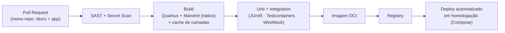

# 🔄 devops — CI/CD, SRE e observabilidade

| Campo | Valor |
|---|---|
| **Papel** — O QUE é | Pipeline, entrega, monitoramento e preocupações transversais de operação técnica do código |
| **Fonte** | dissolvido do SAD §7 (DevOps/SRE) + §10 (cross-cutting) · [ADR-012](adrs/adr-012-stack-onda-1.md) (Onda 1-Must (MVP mínimo) em Compose, CI/CD trunk-based) · [ADR-006](adrs/adr-006-rabbitmq-kafka.md) · ENABLER-0001/ENABLER-0002 (rascunhos de infra) |
| **Dono** | Eng (Bruno Oliveira/backend + Bolismar da Silva/arquiteto) · Infra (Lourival Louro) para o servidor |
| **Status** | ✅ v1 (2026-10-21) · 🚧 execução depende dos ENABLER-0001/0002 (📝 rascunho) |

## 1. CI — a cada PR/push na `main`

- **Trunk-based** com `main` protegida: **PR + ≥1 aprovação obrigatória** (ENABLER-0002 / gate C4).
- **Monorepo**: `/docs` + aplicação no mesmo repositório.
- **Build nativo Mandrel é pesado (CPU/memória)** — **cache de imagem/camadas é mitigação obrigatória desde o dia 1** (risco registrado no ENABLER-0002).
- **SAST + secret scan** entram como etapa do pipeline (padrão SAD §7) — ferramenta a definir na implementação do ENABLER-0002.

## 2. CD — Onda 1-Must (MVP mínimo) (Compose) × alvo Onda 4 (Produto)/Onda 5 (Plataforma) (GitOps)

| Fase | Mecanismo | Decisão |
|---|---|---|
| **Onda 1-Must (MVP mínimo) (agora)** | merge na `main` → build → **deploy 100% automatizado em homologação** via `docker compose` no servidor interno — sem ação manual (DoD ENABLER-0002) | [ADR-012](adrs/adr-012-stack-onda-1.md) |
| **Onda 4 (Produto)/Onda 5 (Plataforma) (SaaS)** | repo GitOps (tag de update) → **Argo CD** → rolling/canary em **K8s (Helm)** | [ADR-009](adrs/adr-009-k8s-istio-keda-compose.md) — fora da Onda 1-Must (MVP mínimo) |

> ✅ **Promoção para produção definida (2026-10-30):** produção usa **ArgoCD** com **entrega contínua (por release ou por demanda)** — deixa de ser ação manual não auditada. Homologação segue em Compose no servidor interno; produção = GitOps/ArgoCD. [PENDENCY-0024](../../../projects/PRJ-SUP-2026-0000-RMR/pendencias.md).

## 3. Observabilidade

| Pilar | Ferramenta | Nota |
|---|---|---|
| **Métricas** | Micrometer → **Prometheus** → **Grafana** | inclui profundidade de fila RabbitMQ e taxa de falha de `INTEGRATION_EVENT` (reconciliação) |
| **Logs** | **Loki** (JSON estruturado) | `{correlation_id, tenant_id, event, timestamp}` — **zero PII** (§4) |
| **Traces** | **OpenTelemetry** → Tempo/Jaeger | `correlation_id` acompanha o evento entre API → fila → adaptador |
| **Alertas** | Grafana/Prometheus | DLQ, circuit breaker aberto, divergência de reconciliação ([integrations §2](integracoes/integrations.md)) |

## 4. Cross-cutting (padrões de código)

| Preocupação | Implementação |
|---|---|
| **Logging** | JSON estruturado com `correlation_id` + `tenant_id`; **sem PII** (evidências/nomes nunca em log) |
| **Error handling** | exceções de **domínio** → status HTTP; **stack trace nunca exposta** ao cliente |
| **Idempotência** | `idempotency_key` em APIs de entrada (R39–R46 · BR-1.4.7) — [ADR-004](adrs/adr-004-acl-outbox.md) |
| **Caching** | Redis para sessão e caches de leitura; invalidação sob demanda |
| **Feature flags** | por tenant (habilita módulos/pacotes SaaS) — ver [../domain.md §4](../domain.md) |

## 5. Rotinas de infraestrutura (complementares)

- **Backup diário automatizado do PostgreSQL** (cronjob) + **teste de restauração** — DoD do [ENABLER-0001](../../../projects/PRJ-SUP-2026-0000-RMR/prj-tecnico/enablers/ENABLER-0001-servidor-interno-docker-compose.md) e prova do checklist jurídico C3.
- **Ambientes e topologia:** [infrastructure.md](infrastructure.md) · nuvem/alvos Onda 4 (Produto)/Onda 5 (Plataforma): [cloud.md](cloud.md).
- **Testes que rodam no pipeline (gates):** [testing.md](testing.md).

## 6. Próximos passos 🟢🟡🔴

- 🟢 Decisões de pipeline fechadas no gate (trunk-based, monorepo, PR+1) — [ADR-012](adrs/adr-012-stack-onda-1.md).
- 🟡 **ENABLER-0002 em rascunho** — executar: repositório, regra de `main`, pipeline, cache Mandrel (9º no WSJF proposto).
- 🟡 Ferramenta de SAST/secret scan a escolher na implementação.
- ✅ **Promoção para produção** definida: ArgoCD com entrega contínua (por release ou por demanda) — §2.
