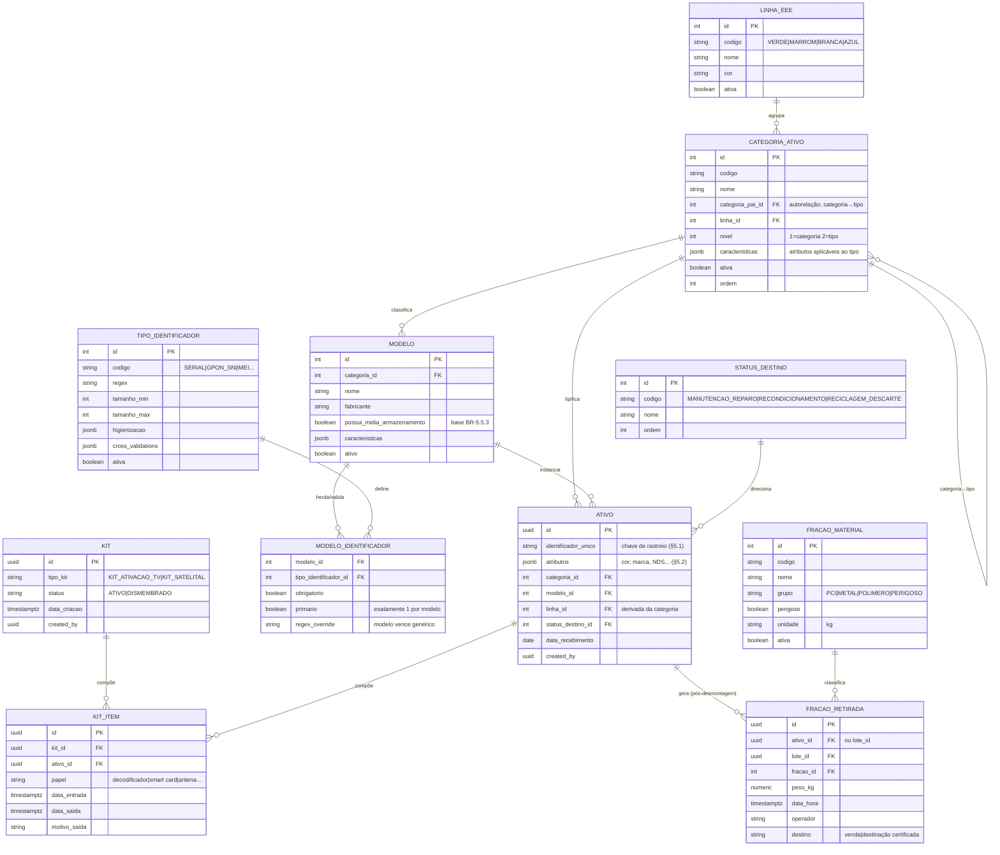
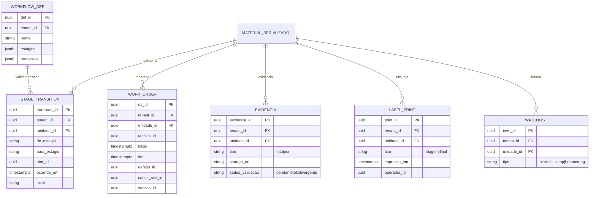
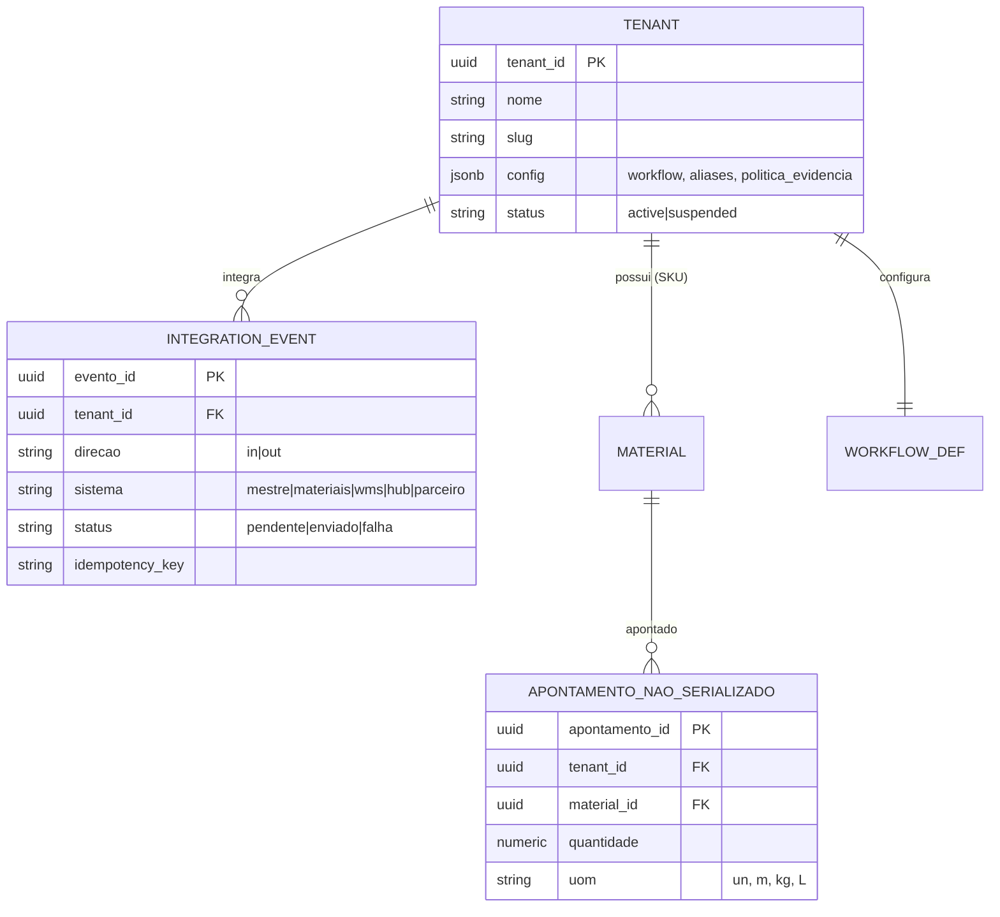

# 🗺️ ERD — diagramas de entidade-relação

| Campo | Valor |
|---|---|
| **Papel** | Diagramas do modelo de dados — leitura visual; decisões de modelo em [mer.md](mer.md) · dicionário em [data-dictionary.md](data-dictionary.md) |
| **Fonte** | [taxonomia-entidades-cadastro-ativos](../../negocio/taxonomia-entidades-cadastro-ativos.md) (9 entidades de negócio — PENDENCY-0002 ✅) · dissolvido do SAD §3 (entidades de plataforma) · ADR-002 (RLS) · ADR-010 (dois níveis de dado) |
| **Status** | ✅ v1 (2026-10-21) · 🟡 correspondência `MATERIAL`/`MATERIAL_SERIALIZADO` × `MODELO`/`ATIVO` a confirmar ([mer.md §4](mer.md)) |

> **Convenção em todos os diagramas:** toda tabela de domínio tem `tenant_id` (FK → `TENANT`) + **RLS** ([ADR-002](adrs/adr-002-rls-multi-tenant.md)) — omitido nos blocos para legibilidade. PKs são `uuid` nas tabelas de operação e `int` (serial) nas *lookups* de seed, conforme a [taxonomia](../../negocio/taxonomia-entidades-cadastro-ativos.md).

## 1. Cadastro & catálogo (fonte da verdade do "que é" e do "que existe")

> `TIPO_IDENTIFICADOR` + `MODELO_IDENTIFICADOR` são **Onda 2-Should (MVP completo)** (DDL no rolling wave da FEATURE-0001.0003 — [taxonomia §5.1.1](../../negocio/taxonomia-entidades-cadastro-ativos.md)). `KIT`/`KIT_ITEM` e `FRACAO_*` nascem **com estrutura na Onda 1-Must (MVP mínimo)** (seeds recebidos), uso posterior — [taxonomia §5.3/§6/§7](../../negocio/taxonomia-entidades-cadastro-ativos.md).

## 2. Operação & workflow (o "work")

> **`MATERIAL_SERIALIZADO`** é o ponto de encontro entre os diagramas 1 e 2 — a unidade física (`ATIVO` no vocabulário da taxonomia). Relação exata entre os dois nomes: [mer.md §4](mer.md) (🟡 a confirmar). `unidade_id` nas tabelas de operação referencia a chave da unidade.

## 3. Tenancy & integração (plataforma)

> `INTEGRATION_EVENT` materializa o padrão **Outbox/Inbox + idempotência** do [ADR-004](adrs/adr-004-acl-outbox.md); detalhe do mapeamento com sistemas externos em [datamapping.md](datamapping.md).

## 4. Legenda & leitura

| Item | Significado |
|---|---|
| `int id` (serial) | *Lookup*/seed — cadastro pequeno e estável |
| `uuid id` | Entidade operacional — geração no app, sem sequência exposta |
| `jsonb` | Config/lista extensível (sem mudança de estrutura — princípio da taxonomia) |
| 🔵 **Onda 2-Should (MVP completo) / Onda 2-Should (MVP completo)** | Tabela nasce com estrutura na Onda 1-Must (MVP mínimo); uso/DDL completo em fase posterior |
| Omissão de `tenant_id` | Presente em todas as tabelas de domínio (RLS — ADR-002) |

**Ordem de leitura sugerida:** [mer.md](mer.md) (decisões e restrições) → este ERD → [data-dictionary.md](data-dictionary.md) (campos) → [datamapping.md](datamapping.md) (sistemas externos).
