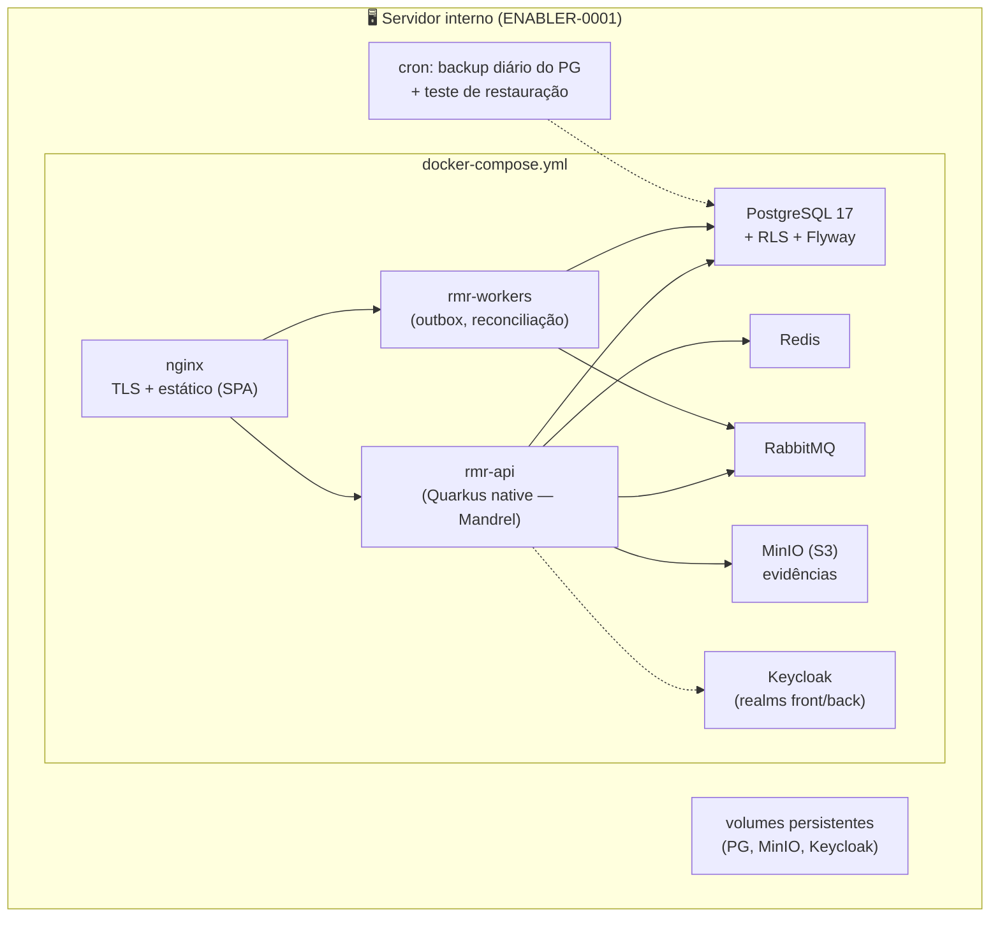
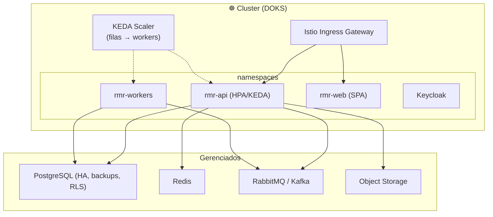

# 🏗️ infrastructure — ambientes e topologia

| Campo | Valor |
|---|---|
| **Papel** — O QUE é | Como o sistema **roda**: ambientes, serviços, volumes, rede e backups — Onda 1-Must (MVP mínimo) (Compose) e topologia alvo (K8s) |
| **Fonte** | dissolvido do SAD §8 (Infrastructure/Cloud) · [ADR-012](adrs/adr-012-stack-onda-1.md) (Onda 1-Must (MVP mínimo) inteira Compose) · [ADR-009](adrs/adr-009-k8s-istio-keda-compose.md) · ENABLER-0001/0002 · [c4-containers.md](c4-containers.md) (contêineres) |
| **Estratégia de nuvem** (cloud providers, critérios, alvos Onda 4 (Produto)/Onda 5 (Plataforma)) | [cloud.md](cloud.md) |
| **Status** | ✅ v1 (2026-10-21) · 🚧 execução = ENABLER-0001 (📝 rascunho — 1º no WSJF) |

## 1. Ambientes

| Ambiente | Fase | Como roda | Uso |
|---|---|---|---|
| **Homolog / Onda 1-Must (MVP mínimo) (dev, homolog e prod)** | **Onda 1-Must (MVP mínimo) (agora)** | **Docker Compose no servidor interno** — idêntico em configuração em todos (ENABLER-0001 §3) | único ambiente da Onda 1-Must (MVP mínimo): desenvolvimento, homologação e produção nele |
| **Homolog / Prod (SaaS)** | **Onda 4 (Produto)/Onda 5 (Plataforma)** | **Kubernetes (DOKS) + Istio + KEDA** — namespaces por carga | quando a Onda 1-Must (MVP mínimo) virar SaaS ([ADR-009](adrs/adr-009-k8s-istio-keda-compose.md)) |

> **Guardrail da Onda 1-Must (MVP mínimo) (ADR-012):** zero dependências externas — tudo auto-hospedado no servidor interno.

## 2. Topologia da Onda 1-Must (MVP mínimo) — Docker Compose (servidor interno)

| Item | Decisão |
|---|---|
| **Servidor** | máquina física/virtual **dedicada, interna** (provisionamento ENABLER-0001) |
| **Sobe do zero** | `docker compose up -d` sem erros de dependência (DoD ENABLER-0001) |
| **Volumes** | PG, MinIO e Keycloak em volumes nomeados (sobrevivem a `compose down`) |
| **Backups** | **cronjob diário do PostgreSQL** + **teste de restauração** (DoD ENABLER-0001 · prova C3 do [checklist jurídico](../../../projects/PRJ-SUP-2026-0000-RMR/prj-negocio/requisitos/checklist-juridico-compliance.md)) |
| **Build** | **nativo Mandrel é pesado** — build no CI com **cache de camadas** obrigatório desde o dia 1 ([devops §1](devops.md)) |
| **Keycloak / pipeline** | respectivamente ENABLER-0003 / ENABLER-0002 — fora do escopo do ENABLER-0001 |

## 3. Topologia alvo — Kubernetes (Onda 4 (Produto)/Onda 5 (Plataforma))

- **KEDA escala os workers** pela profundidade da fila (eventos Outbox/Inbox são intrinsecamente assíncronos — ADR-006).
- **Sem especificidade K8s no código** (12-factor): a mesma imagem OCI roda no Compose da Onda 1-Must (MVP mínimo) e no cluster.
- Detalhe do alvo de nuvem (DOKS, Kong, Redis gerenciado): [cloud.md](cloud.md).

## 4. Recursos (dimensionamento) 🟡

| Item | Situação |
|---|---|
| Servidor da Onda 1-Must (MVP mínimo) (CPU/RAM/disco) | 🟡 **a dimensionar** com o ENABLER-0001 — considerar build Mandrel no CI + PG + 8 serviços Compose |
| Custo do alvo SaaS Onda 4 (Produto)/Onda 5 (Plataforma) | 🟡 a estimar quando o SaaS for contratado ([cloud.md §6](cloud.md)) |

## 5. Próximos passos

1. Executar **ENABLER-0001** (servidor + Compose base + backup/restauração) — bloqueador crítico das 13 stories.
2. **ENABLER-0002** (pipeline) no mesmo servidor de CI — cache Mandrel desde o 1º build.
3. Dimensionar recursos (§4) após o primeiro `compose up` completo.
