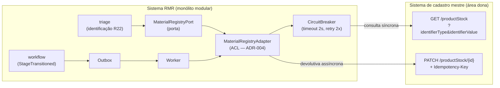
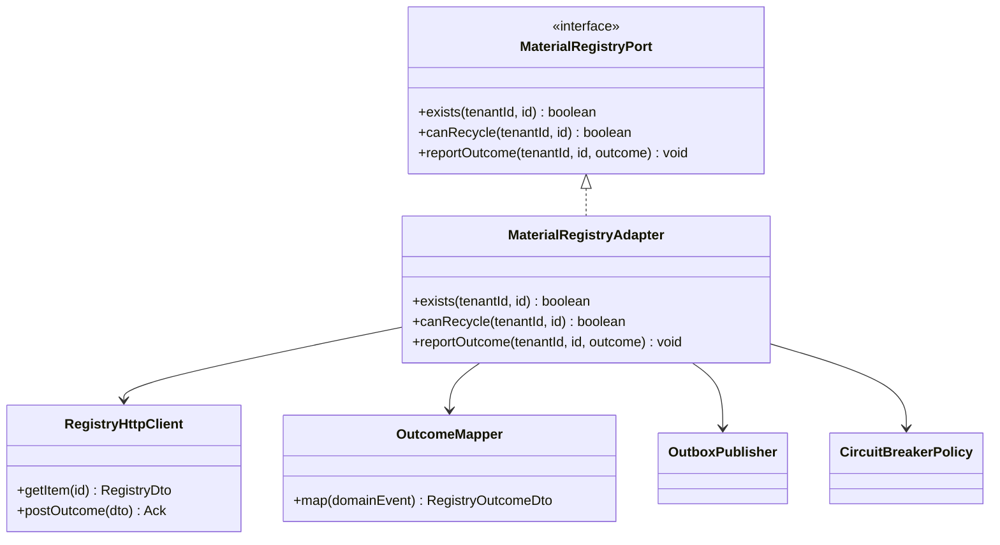
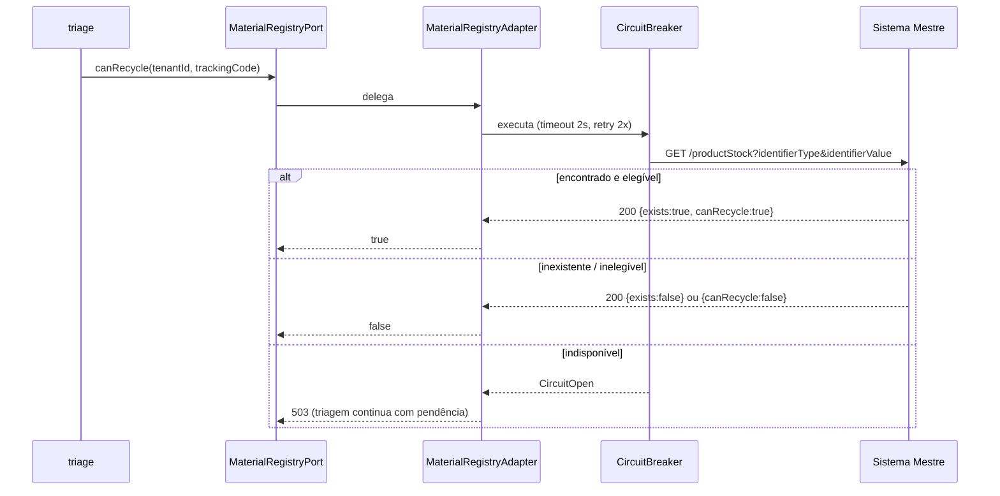
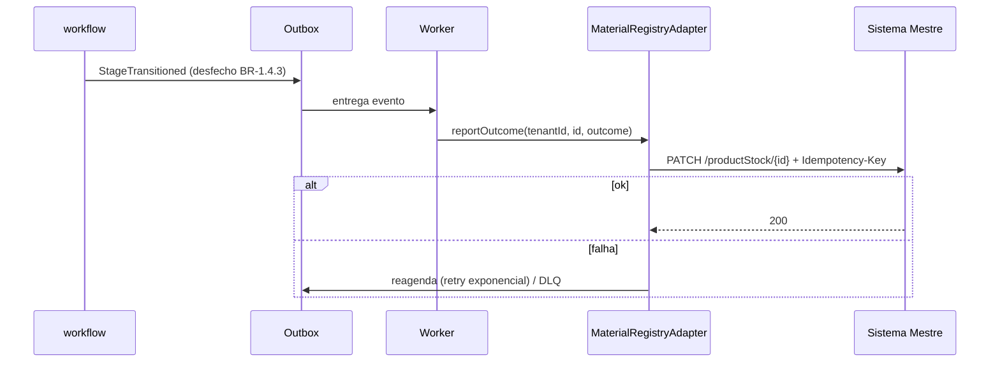

# 🔌 Integração — Cadastro Mestre de Materiais Serializados

| Campo | Valor |
|---|---|
| **Responde** | **PENDENCY-0014** ✅ respondida em 2026-10-21 — [hub](../../../../projects/PRJ-SUP-2026-0000-RMR/pendencias.md) |
| **Requisitos** | **R17** (validação no cadastro), **R22** (identificação na triagem), **R48** (devolutiva/fechar o loop) |
| **Regras** | **BR-1.4.6** (REST genérica API-First — API canônica de referência **TMF639 · Resource Inventory**) · **BR-1.4.7** (idempotência da devolutiva) · desfechos **BR-1.4.3** (retorno do campo · sucateado · expedido) |
| **Decisão** | [ADR-004 — ACL + Outbox/Inbox](../adrs/adr-004-acl-outbox.md) |
| **Contrato** | [../integracoes/contratos/openapi-cadastro-mestre.yaml](contratos/openapi-cadastro-mestre.yaml) |
| **Dono** | Eng + **área dona do cadastro mestre** (fechamento do contrato) |
| **Consumido por** | [FEATURE-0001.0004](../../../../projects/PRJ-SUP-2026-0000-RMR/prj-produto/features/FEATURE-0001.0004-validacao-identificador-cadastro-mestre.md) (BR-1.4.6/1.4.7) · US-0018/0019 · triagem/watchlist (consulta elegibilidade) |
| **Status** | 📝 **PROPOSTA** — fechamento do contrato com a área dona pendente (§9 — [PENDENCY-0020](../../../../projects/PRJ-SUP-2026-0000-RMR/pendencias.md)) |

---

## 1. Objetivo e escopo (integração bidirecional)

- **Consulta (síncrona):** o item **existe** no cadastro mestre? **pode entrar** no processo de manutenção/reciclagem?
- **Devolutiva (assíncrona):** informar o **desfecho** do ativo ao sistema central (BR-1.4.3) — fechar o loop de rastreio.

## 2. Visão da integração

## 3. Componentes (ACL)

## 4. Fluxo — consulta na triagem

## 5. Fluxo — devolutiva de desfecho (fechar o loop)

## 6. Contrato de saída (consulta)

- **`GET /productStock?identifierType={TIPO}&identifierValue={CODIGO}`** — parâmetros via *query string* (operação de leitura filtrada).
  - `identifierType` (enum do catálogo R15): `SERIAL, SMART_CARD, SCID, CAID, CAS, GPON_SN, SAT_KIT_SN, IMEI, ICCID, IMSI`
  - Ex.: `…/productStock?identifierType=GPON_SN&identifierValue=HWTC1A2B3C4D`
- **200** → payload em **lista** (`[]` — identificadores são chaves exclusivas, mas o padrão TMF devolve coleção) com dados básicos do hardware, **status atual** (em campo/estocado) e o **agrupador lógico (NDS)** — `id`, `href`, `name`, `status`, `productSpecification`, `productCharacteristic[]` (GPON_SN, MAC_ADDRESS, NDS), `place`.
- **404** (`ERR_ASSET_NOT_FOUND`) → **regra de negócio:** a interface **bloqueia** o fluxo de manutenção da peça e orienta o técnico a abrir chamado de *"Saneamento de Inventário/Carga de Saldo"* antes de prosseguir — 404 não é erro técnico, é insumo de saneamento.

## 7. Contrato de devolutiva (atualização)

- **`PATCH /productStock/{id}`** (atualização parcial — só o status do ciclo de vida) com **`Idempotency-Key`** no header (**BR-1.4.7**) e corpo: `status` + `statusChangeReason` + `statusChangeDate`.
- **200** → registro atualizado confirmou a transação · **400** validação/transição inválida · **404** id inexistente.
- ⚠️ **A alinhar no fechamento (§9):** os cenários do contrato de partida (*entrada em manutenção · reparado · descartado*) pertencem ao ciclo de **reparo**; os desfechos da **BR-1.4.3** são **retorno do campo · sucateado · expedido** — o mapeamento desfecho→status fica no fechamento com a área dona.

## 8. Resiliência e erros

| Situação | Resposta |
|---|---|
| Item inexistente no cadastro mestre | `canRecycle=false` / 404 → saneamento (§6) — não é erro técnico |
| Sistema indisponível | Circuit breaker → registra **pendência de integração**; triagem **não fica bloqueada** (503 no retorno síncrono) |
| Devolutiva falha | Retry exponencial → **DLQ** + alerta |
| Divergência de identificador | **Reconciliação** periódica (hub de integrações §2) |
| Reenvio duplicado | `Idempotency-Key` (entrada) · Inbox (parceiros) — ADR-004 |

- **Timeout curto (2s) + tentativas limitadas** na consulta — nunca bloquear a triagem.
- **Timeout/retry/fila:** seguem o **padrão do time técnico**; desvio só por regra em FEATURES/US (decisão PENDENCY-0014).
- Nenhum termo proprietário no domínio — tudo via `MaterialRegistryPort` (ACL).

## 9. Pendências de fechamento (área dona do cadastro mestre) — [PENDENCY-0020](../../../../projects/PRJ-SUP-2026-0000-RMR/pendencias.md)

1. **Alinhamento TMF639:** os payloads de partida são base **TMF687 (Stock)** — alinhar aos schemas **TMF639** (`/resource`, `/resourceAttributeValue`) — decidido em PENDENCY-0014, fechamento aqui.
2. **Mapeamento desfechos BR-1.4.3 → status do sistema mestre** (§7 — cenários × desfechos não batem 1:1).
3. **URL base, escopos OAuth2 e catálogo de status** confirmados com a área dona.

## 10. Rastreabilidade

| Elemento | ADR | Req./Regra | Onde vive |
|---|---|---|---|
| `MaterialRegistryPort` (ACL) | [ADR-004](../adrs/adr-004-acl-outbox.md) | R17, R22, R48 | §3 |
| Devolutiva via Outbox + idempotência | [ADR-004](../adrs/adr-004-acl-outbox.md) | R48 · BR-1.4.7 | §5, §7 |
| Circuit breaker / resiliência | [ADR-004](../adrs/adr-004-acl-outbox.md) | R46 | §8 |
| API genérica (API-First, TMF639) | — | BR-1.4.6 | §6, §9 |
| Desfechos do ciclo | — | BR-1.4.3 | §7 |

> **Origem:** consolidado em 2026-10-21 na rodada PENDENCY-0014 (pesquisa de contrato de consulta + devolutiva + decisões do hub) — conteúdo absorvido, sem dependência de material de rascunho.
