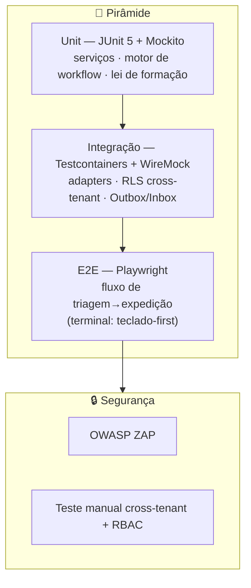

# 🧪 testing — arquitetura de testes, gates e rastreabilidade

| Campo | Valor |
|---|---|
| **Papel** — O QUE é | Pirâmide de testes, ferramentas, gates do pipeline e a matriz de rastreabilidade decisões→requisitos |
| **Fonte** | dissolvido do SAD §9 (Testing) + §11 (Traceability) · [ADR-002](adrs/adr-002-rls-multi-tenant.md) (consequência: testes cross-tenant) · [ADR-003](adrs/adr-003-workflow-configuravel.md) · [ADR-013](adrs/adr-013-frontend-spa.md) (Playwright) · ENABLER-0002 (gates no pipeline) |
| **Status** | ✅ v1 (2026-10-21) |

## 1. Pirâmide

| Camada | Ferramenta | O que cobre |
|---|---|---|
| **Unit** | JUnit 5 + Mockito | regras de domínio, **motor de workflow** (matriz de transições + pré-condições), **lei de formação** (regex/higienização/cross-validações — [regras](../../negocio/regras-formacao-identificadores.md)) |
| **Integração** | Testcontainers + WireMock | **RLS cross-tenant** (query de outro tenant = 0 linhas — ADR-002), adapters ACL contra **stub WireMock** do cadastro mestre, **Outbox/Inbox + idempotência** (BR-1.4.7), migrations Flyway + seeds |
| **E2E** | Playwright | fluxo completo triagem→expedição; **keyboard-first** (sem mouse) validado — ADR-013 |
| **Segurança** | OWASP ZAP + teste manual | API scan + checklist manual de cross-tenant/RBAC/telas por perfil |

## 2. Gates do pipeline

| Gate | Conteúdo | Bloqueia |
|---|---|---|
| **1** | Build + unit | merge na `main` |
| **2** | Integração (Testcontainers, **RLS**, Outbox) | merge/deploy |
| **3** | Segurança (ZAP + manual) | release |
| **4** | Performance/carga | release |
| **5** | Go-live (restauração de backup, rollback) | produção |

> Gates 1–2 rodam **em cada PR** (pipeline — [devops §1](devops.md)); 3–5 em cadência de release. **Teste de restauração de backup** no gate 5 = DoD do [ENABLER-0001](../../../projects/PRJ-SUP-2026-0000-RMR/prj-tecnico/enablers/ENABLER-0001-servidor-interno-docker-compose.md).

## 3. Onde o risco decide a cobertura

| Risco | Teste obrigatório | Origem |
|---|---|---|
| Vazamento entre tenants | matriz cross-tenant por tabela de domínio (sucesso + **0 linhas**) | ADR-002 |
| Transição inválida de estágio | matriz de transições × pré-condições × perfis | ADR-003 |
| Reenvio duplicado de parceiro/devolutiva | idempotência (mesma `idempotency_key` ×2 = 1 efeito) | ADR-004 · BR-1.4.7 |
| Circuito aberto do cadastro mestre | stub indisponível → triagem **não bloqueia** (503 + pendência) | [integracao-cadastro-mestre §8](integracoes/integracao-cadastro-mestre.md) |
| Lei de formação | tabela de casos: higienização, regex por tipo/modelo, NDS ≤32 | PENDENCY-0012 |

## 4. Rastreabilidade (SAD §11 dissolvido)

| ADR | Requisitos (PEDIDO) | Decisão (BRAINSTORM) |
|---|---|---|
| [ADR-001](adrs/adr-001-monolito-modular.md) Monólito modular | Todos | §6.3 |
| [ADR-002](adrs/adr-002-rls-multi-tenant.md) RLS multi-tenant | R1–R5, SaaS | Premissa 1, §6.4 |
| [ADR-003](adrs/adr-003-workflow-configuravel.md) Workflow configurável | R14, R20 | §4.1, §6.6 |
| [ADR-004](adrs/adr-004-acl-outbox.md) ACL + Outbox | R17, R38–R48 | §6.5, §7 |
| [ADR-005](adrs/adr-005-keycloak-oidc.md) Keycloak | R1–R5 | §6.8 |
| [ADR-006](adrs/adr-006-rabbitmq-kafka.md) RabbitMQ/Kafka | R39–R46 | §6.5 |
| [ADR-007](adrs/adr-007-evidencia-configuravel.md) Evidência configurável | Premissa 5, R59 | §2.3.1, §6.6 |
| [ADR-008](adrs/adr-008-read-models-cqrs.md) Read models | R49–R57 | §9 |
| [ADR-009](adrs/adr-009-k8s-istio-keda-compose.md) K8s/Istio/KEDA + Compose | — | §6, §8 |
| [ADR-010](adrs/adr-010-dois-niveis-dado.md) Dois níveis de dado | R15, R21, R49 | §2.3, §8 |
| [ADR-011](adrs/adr-011-motor-recuperacao-valor.md) Recuperação de Valor | B-REQ-09/10, Premissa 7 | §2.6, §10 |
| [ADR-012](adrs/adr-012-stack-onda-1.md) Stack da Onda 1-Must (MVP mínimo) | R1–R5, R20 (Onda 1-Must (MVP mínimo)) | §6.2 (atualizado 2026-10-19) |
| [ADR-013](adrs/adr-013-frontend-spa.md) Frontend SPA | R1–R5, R20–R37 | §6 — decidido 2026-10-19 (spike ENABLER-0009) |

> Índice geral com status: [adrs/INDEX.md](adrs/INDEX.md).

## 5. Próximos passos

1. Materializar gates 1–2 no ENABLER-0002 (pipeline).
2. **Suíte cross-tenant** nascer junto do DDL de `tenancy`/migrations (ENABLER-0004) — não depois.
3. Gate 3 (ZAP) agendar na primeira release candidata a produção.
