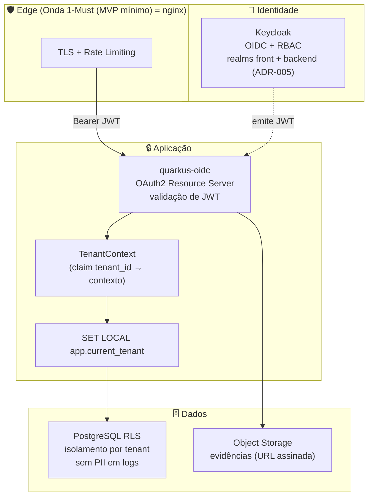

# 🔐 SECURITY — segurança, multi-tenancy e conformidade (visão técnica)

> 🏛️ **Definições corporativas:** o baseline transversal de segurança (Keycloak OIDC/RBAC,
> isolamento multi-tenant via RLS, modelo de ameaças STRIDE, práticas LGPD, auditoria
> imutável) vive em
> [`platform-standards/standards/security/SECURITY.md`](https://github.com/fbso-techsolutions/platform-standards/blob/main/standards/security/SECURITY.md).
> Este documento cobre as premissas de segurança **específicas do produto RMR**.

| Campo | Valor |
|---|---|
| **Papel** — O COMO (técnico) | Implementação técnica das exigências de segurança: autenticação/autorização, isolamento multi-tenant, auditoria, LGPD-técnico e modelo de ameaças |
| **Fonte** | dissolvido do SAD §4 (Security & Multi-Tenancy + STRIDE) · [ADR-002](../arquitetura/adrs/adr-002-rls-multi-tenant.md) (RLS) · [ADR-005](../arquitetura/adrs/adr-005-keycloak-oidc.md) (Keycloak) · [ADR-004](../arquitetura/adrs/adr-004-acl-outbox.md) (Inbox/R46) |
| **Négócio/Conformidade** | LGPD, wipe certificado (B-REQ-05), MTR/PNRS → [checklist-juridico-compliance](../../../projects/PRJ-SUP-2026-0000-RMR/prj-negocio/requisitos/checklist-juridico-compliance.md) · este doc cobre a **camada técnica** |
| **Status** | ✅ v1 (2026-10-21) · 🚧 execução: ENABLER-0003 (Keycloak, 📝) · gate ZAP pendente ([testing §2](../arquitetura/testing.md)) — PENDENCY-0025 |

## 1. Arquitetura de segurança

## 2. Mecanismos

| Exigência (négócio) | Implementação técnica |
|---|---|
| **RBAC + telas por perfil** (R1) | papéis/escopos no Keycloak + autorização por recurso na API; perfil define telas no front (SPA) |
| **Login único / sessão** (R2–R5) | configuração Keycloak: sessão única, inativação por inatividade, troca periódica de senha, reset com notificação (`notification`) |
| **Multi-tenant (SaaS/Premissa 1)** | `tenant_id` da **claim do JWT** (nunca do corpo) → `SET LOCAL` → **RLS** — query cross-tenant devolve **0 linhas** ([ADR-002](../arquitetura/adrs/adr-002-rls-multi-tenant.md)) |
| **Auditoria imutável** (R59) | `STAGE_TRANSITION`, `LABEL_PRINT`, `INTEGRATION_EVENT` **append-only** — sem `UPDATE`/`DELETE` de negócio |
| **Evidências** (Premissa 5) | binário em object storage + **URL assinada** curta; metadado no PG; RBAC na entrega ([ADR-007](../arquitetura/adrs/adr-007-evidencia-configuravel.md)) |
| **Idempotência** (R39–R46, BR-1.4.7) | `idempotency_key` + Inbox — reenvio não duplica ([ADR-004](../arquitetura/adrs/adr-004-acl-outbox.md)) |
| **Zero PII em log** | logging JSON só com `correlation_id`/`tenant_id`/evento ([devops §4](../arquitetura/devops.md)) |

## 3. Modelo de ameaças (STRIDE — recorte)

| Ameaça | Mitigação técnica | Comprovante |
|---|---|---|
| **Spoofing** — usuário acessa outro tenant | RLS + `tenant_id` da claim (não do payload) | teste cross-tenant (gate 2) |
| **Tampering** — payload de parceiro alterado | assinatura/mTLS no canal + `idempotency_key` + validação de lei de formação/ordem (R46) | WireMock + validadores no hub |
| **Repudiation** — nega transição/impressão | `STAGE_TRANSITION` + `LABEL_PRINT` imutáveis com `ator_id` | auditoria append-only |
| **Information Disclosure** — vazamento cross-tenant/foto | RLS defensivo + URL assinada + RBAC por tela + sem PII em log | gate 2 (RLS) + gate 3 (ZAP) |
| **DoS** — enxurrada nas APIs | rate limit no edge + fila/backpressure no hub | alerta de fila (devops §3) |
| **Elevation of Privilege** — troca etapa sem permissão | pré-condições do workflow × RBAC ([ADR-003](../arquitetura/adrs/adr-003-workflow-configuravel.md)) | matriz de transições (testing §3) |

## 4. LGPD na camada técnica

| Prática | Onde |
|---|---|
| **Minimização** — só os dados necessários por tela/fluxo | APIs por perfil; `atributos` JSONB por categoria |
| **Anonimização em analytics** | read models/dashboards sem identificadores de pessoa ([ADR-008](../arquitetura/adrs/adr-008-read-models-cqrs.md)) |
| **Retenção/destruição** — wipe certificado de mídia | négócio: [checklist-juridico-compliance](../../../projects/PRJ-SUP-2026-0000-RMR/prj-negocio/requisitos/checklist-juridico-compliance.md) (B-REQ-05); técnica: trava por `MODELO.possui_midia_armazenamento` → etapa com evidência ([data-dictionary §2](../arquitetura/data-dictionary.md)) |
| **Sem sub-processador na Onda 1-Must (MVP mínimo)** | guardrail zero dependências externas ([cloud §1](../arquitetura/cloud.md)) |
| **Backup protegido** | backup diário + restauração testada (ENABLER-0001) |

## 5. Compliance ambiental (perspectiva técnica)

- **MTR**: nº registrado **manualmente** na Onda 1-Must (MVP mínimo) (decisão checklist B1) — coluna em evento de expedição a modelar com o DDL; integração = evolução.
- **CDF** (PENDENCY-0010): tabela própria quando decidida — fora da Onda 1-Must (MVP mínimo).
- **Rastreio de destinação**: `STAGE_TRANSITION` (desfecho BR-1.4.3) + `FRACAO_RETIRADA.destino` dão a trilha — [mer.md §3](../arquitetura/mer.md).

## 6. Lacunas e próximos passos 🟢🟡🔴

- 🟢 RLS/Keycloak/auditoria decididos no gate 9/9 e desdobrados em ADRs.
- 🟡 **ENABLER-0003 em rascunho** — realms, papéis/telas, política de senha (B1).
- 🟡 **Gate 3 (ZAP + manual cross-tenant)** sem cronograma — agendar na 1ª release candidata a produção ([testing §5](../arquitetura/testing.md)) — **PENDENCY-0025**.
- 🟡 **Federação AD** no Keycloak = Onda 4 (Produto)/Onda 5 (Plataforma) (não Onda 1-Must (MVP mínimo)).
- 🔴 Coluna de **MTR** e ritual de **wipe certificado** dependem do DDL da expedição e da decisão de negócio — acompanhar BACKLOG (**PENDENCY-0028**).
