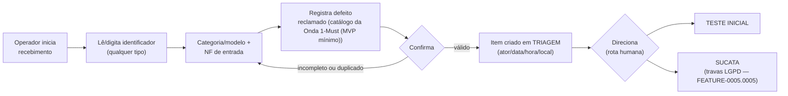

# ✨ FEATURE-0001.0001 — Tela de recebimento de ativos e digitação de defeito

| Campo | Valor |
|---|---|
| Projeto | PRJ-SUP-2026-0000-RMR (RMR Reversa) |
| Épico | [EPIC-0001 — Logística Reversa e Triagem](../epicos/EPIC-0001-logistica-reversa-e-triagem.md) |
| B-REQ dona | **B-REQ-01** (Cadastro Simplificado de Ativos de TI) |
| Prioridade | **Onda 1-Must (MVP mínimo)** (Sprint 2) — ver [escopo da Onda 1-Must (MVP mínimo)](../escopo-onda-1.md) |
| Requisitos (PEDIDO) | R6, R15, R20, R21, R25 — [PEDIDO](../../prj-negocio/discovery/PEDIDO.md) |
| Depende de | **nada externo** (Onda 1-Must (MVP mínimo) sem sistemas externos) |
| Entra depois | FEATURE-0001.0003 (cadastros mestres) · FEATURE-0001.0004 (validação no cadastro mestre) · FEATURE-0002.0002 (etiquetas) |
| User stories | [US-FEAT-0001.0001-0001](../user-stories/US-FEAT-0001.0001-0001-registro-recebimento-ativo.md) · [US-FEAT-0001.0001-0002](../user-stories/US-FEAT-0001.0001-0002-defeito-reclamado-recebimento.md) · [US-FEAT-0001.0001-0003](../user-stories/US-FEAT-0001.0001-0003-direcionamento-para-proxima-etapa.md) |
| 🔒 Travada por | [ENABLER-0001](../../prj-tecnico/enablers/ENABLER-0001-servidor-interno-docker-compose.md) · [ENABLER-0003](../../prj-tecnico/enablers/ENABLER-0003-keycloak-perfis.md) · [ENABLER-0004](../../prj-tecnico/enablers/ENABLER-0004-policies-rls-tenant.md) · [ENABLER-0005](../../prj-tecnico/enablers/ENABLER-0005-flyway-entidades-seeds.md) · [ENABLER-0007](../../prj-tecnico/enablers/ENABLER-0007-auditoria-append-only.md) · [ENABLER-0008](../../prj-tecnico/enablers/ENABLER-0008-terminais-leitores.md) · [ENABLER-0009](../../prj-tecnico/enablers/ENABLER-0009-decisao-stack-front.md) |
| Status | 📝 Rascunho (2026-10-16) |

## 1. Objetivo

Receber o ativo que chega da logística reversa, **identificá-lo e categorizá-lo**, registrar o **defeito reclamado** e inseri-lo na etapa **TRIAGEM** do workflow — o primeiro passo da fatia Onda 1-Must (MVP mínimo).

## 2. Escopo

### Entra
- Registro de recebimento: **Identificador Físico do Ativo** ([catálogo de tipos](../../../../docs/negocio/taxonomia-entidades-cadastro-ativos.md) — serial, IMEI, smart card… — leitura por leitor ou digitação), **categoria/modelo** do ativo, **nota fiscal de entrada** e controle logístico quando houver (R21).
- Registro do **defeito reclamado** no momento do recebimento (R6).
- Inserção automática na etapa **TRIAGEM** com **trilha de auditoria** — ator, data/hora, local e identificador lido (R20).
- Roteamento pós-triagem para **teste inicial** ou **sucata** (R25) — decisão **humana** na Onda 1-Must (MVP mínimo) (motor FEATURE-0001.0002 é Onda 2-Should (MVP completo)).
- Cadastro mínimo de modelos/categorias da Onda 1-Must (MVP mínimo) (**1 modelo**, por decisão de fatiamento).

### Fora (nesta feature)
- Validação no cadastro mestre/origem → **FEATURE-0001.0004** · Etiquetas → **FEATURE-0002.0002** · Cadastros mestres completos → **FEATURE-0001.0003** · Busca rápida → **FEATURE-0002.0003** · Dashboards → **FEATURE-0002.0004**.
- Watchlist (blacklist/scrap/boomerang — R23) → **[FEATURE-0001.0005](FEATURE-0001.0005-watchlist-triagem.md)** (PENDENCY-0001 ✅).

## 3. Regras de negócio

| ID | Regra |
|---|---|
| BR-1.1.1 | Todo ativo recebido recebe registro único com identificador; **um item em processo ativo não pode ser recebido duas vezes** (bloqueio com aviso) — *regra **confirmada** com as áreas em 2026-10-16 ([checklist C1](../discovery/checklist-operacao-po-onda-1.md))* |
| BR-1.1.2 | Recebimento exige: identificador + categoria/modelo + NF de entrada |
| BR-1.1.3 | O defeito reclamado é selecionado do **cadastro mínimo embutido da Onda 1-Must (MVP mínimo)** (decisão [D-02](../backlog/DECISOES-BACKLOG.md); FEATURE-0001.0003 assume o catálogo completo em Onda 2-Should (MVP completo)) |
| BR-1.1.4 | Ao concluir, o item nasce em **TRIAGEM** e a transição registra ator, data/hora, local e identificador (R20) |
| BR-1.1.5 | O direcionamento pós-triagem (teste inicial × sucata) é **manual** na Onda 1-Must (MVP mínimo) — rota automática vem com FEATURE-0001.0002 (Onda 2-Should (MVP completo)) |
| BR-1.1.6 | Tela operada com **leitor de código + terminal**: campo do identificador sempre focado, sem mouse (BRAINSTORM §6.7) |
| BR-1.1.7 | Direcionar para **sucata** encaminha o item à rota de descarte com as **travas LGPD da FEATURE-0005.0005** |

## 4. Fluxo

## 5. User stories desta feature

| ID | História | Critérios |
|---|---|---|
| [US-FEAT-0001.0001-0001](../user-stories/US-FEAT-0001.0001-0001-registro-recebimento-ativo.md) | Registrar recebimento de ativo na triagem | 4 AC |
| [US-FEAT-0001.0001-0002](../user-stories/US-FEAT-0001.0001-0002-defeito-reclamado-recebimento.md) | Registrar defeito reclamado no recebimento | 3 AC |
| [US-FEAT-0001.0001-0003](../user-stories/US-FEAT-0001.0001-0003-direcionamento-para-proxima-etapa.md) | Direcionar item para próxima etapa | 4 AC |

## 6. Pendências ✅ resolvidas → [hub](../../pendencias.md)

1. ✅ **PENDENCY-0001 — R23 — Watchlist** (blacklist/scrap/boomerang): **decidida em 2026-10-16 — nova feature [FEATURE-0001.0005](../rastreabilidade.md)** (EPIC-0001, Onda 2-Should (MVP completo), fora da Onda 1-Must (MVP mínimo)), absorvendo R19 (cadastro) + R23 (validação na triagem).
2. ✅ **PENDENCY-0002 — Taxonomia de categorias** da B-REQ-01 — **respondida em 2026-10-16**: estrutura de entidades criada primeiro ([taxonomia-entidades-cadastro-ativos](../../../../docs/negocio/taxonomia-entidades-cadastro-ativos.md)) — 3 eixos (destino × linha oficial × fração), Onda 1-Must (MVP mínimo) = Linha Verde, tabelas aptas às demais linhas.
3. ✅ **PENDENCY-0009 — Regras derivadas** — **confirmadas em 2026-10-16** ([checklist C1/C2](../discovery/checklist-operacao-po-onda-1.md)): BR-1.1.1 (bloqueio de duplicidade) e US-FEAT-0002.0005-0010 cen. 3 (item só sai uma vez, agora BR-2.5.3 na [FEATURE-0002.0005](../rastreabilidade.md)).

## 7. Critérios de aceite da feature (definition of done)

- [ ] Um item novo percorre recebimento → TRIAGEM → rota escolhida com auditoria completa (quem/quando/onde).
- [ ] Duplicidade de identificador bloqueada (BR-1.1.1).
- [ ] Nenhuma operação exige mouse (leitor/atalhos).
- [ ] **Zero** dependência de sistemas externos (pré-requisito da Onda 1-Must (MVP mínimo)).
- [ ] Direcionar para sucata dispara as travas da FEATURE-0005.0005.
