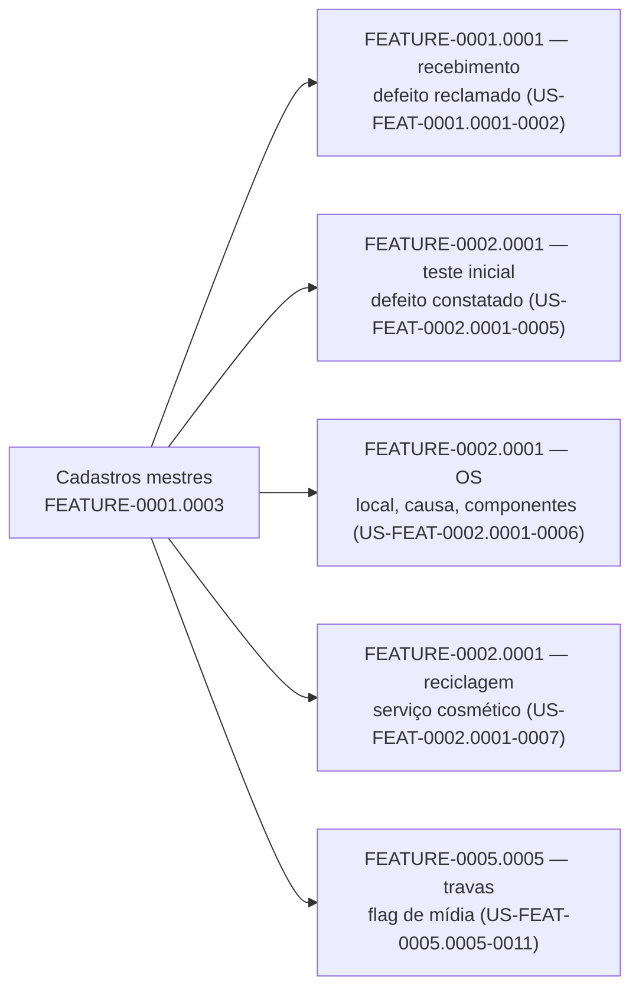

# ✨ FEATURE-0001.0003 — Cadastros mestres de apoio (diagnóstico, serviços, modelos, materiais)

| Campo | Valor |
|---|---|
| Projeto | PRJ-SUP-2026-0000-RMR (RMR Reversa) |
| Épico | [EPIC-0001 — Logística Reversa e Triagem](../epicos/EPIC-0001-logistica-reversa-e-triagem.md) |
| B-REQ dona | **B-REQ-01** (apoio ao cadastro de ativos) |
| Prioridade | **Onda 2-Should (MVP completo)** (fora da Onda 1-Must (MVP mínimo) — rolling wave) — ver [backlog](../../../../docs/produto/backlog/BACKLOG-LIST.md) |
| Requisitos (PEDIDO) | R6–R16 (+ R18 pendente) — [PEDIDO](../../prj-negocio/discovery/PEDIDO.md) |
| Depende de | [taxonomia-entidades-cadastro-ativos](../../../../docs/negocio/taxonomia-entidades-cadastro-ativos.md) (estrutura de categorias/modelos — **PENDENCY-0002**) |
| Alimenta | **FEATURE-0001.0001** (defeito reclamado) · **FEATURE-0002.0001** (teste/OS/reciclagem) · **FEATURE-0005.0005** (flag de mídia por modelo — BR-5.5.3) |
| User stories | [US-FEAT-0001.0003-0014](../user-stories/US-FEAT-0001.0003-0014-cadastros-defeitos-locais-causas.md) · [US-FEAT-0001.0003-0015](../user-stories/US-FEAT-0001.0003-0015-cadastros-servicos-executados.md) · [US-FEAT-0001.0003-0016](../user-stories/US-FEAT-0001.0003-0016-cadastro-modelos-equipamento.md) · [US-FEAT-0001.0003-0017](../user-stories/US-FEAT-0001.0003-0017-cadastro-materiais-insumos.md) |
| 🔒 Travada por | — (livre) |
| Status | 📝 Rascunho (2026-10-16) |

## 1. Objetivo

Centralizar o **cadastro das listas mestres** que as telas operacionais consultam por combinação — defeitos, locais, causas raiz, serviços, modelos e insumos — padronizando a digitação e sustentando rastreabilidade (uma OS sempre referencia um item cadastrado, nunca texto livre).

## 2. Escopo

### Entra
- **Listas de diagnóstico:** defeito **reclamado** (R6) e **constatado** (R7), local danificado (R8), causa raiz (R9) — CRUD + desativação.
- **Serviços:** serviço executado (R10), **sem conserto/sucata** (R11), serviço no **HDD** (R12), serviços de **reciclagem estética** (R13) — CRUD com tipo.
- **Modelos de equipamento** (R15): código do ERP corporativo (genérico — qualquer ERP), descrição, fornecedor, **lei de formação dos identificadores físicos e do NDS** (por tipo/modelo — [catálogo §5.1](../../../../docs/negocio/taxonomia-entidades-cadastro-ativos.md)), categoria/tipo (taxonomia) e **flag de mídia de armazenamento**.
- **Materiais e insumos** (R16): código do ERP + descrição (ex.: cabo HDMI, fonte, antena).

### Fora
- **R14** (permissões de serviço por defeito) e **R18** (níveis de reparo/reciclagem por fornecedor) → **PENDENCY-0003** (Onda 2-Should (MVP completo) — configuração de workflow/catálogo).
- Validação no cadastro mestre → **FEATURE-0001.0004** · Watchlist → **FEATURE-0001.0005** · fluxo operacional → FEATURE-0001.0001/FEATURE-0002.0001.

## 3. Regras de negócio

| ID | Regra |
|---|---|
| BR-1.3.1 | Telas operacionais (recebimento, teste, OS, reciclagem) **selecionam** itens das listas mestres — sem texto livre para dados classificáveis |
| BR-1.3.2 | Item de cadastro nunca é **excluído** — apenas **desativado** (some das escolhas novas, preserva histórico/auditoria) |
| BR-1.3.3 | **Modelo de equipamento** (R15): código do ERP + descrição + fornecedor + **lei de formação dos identificadores físicos e do NDS** (por tipo/modelo — [catálogo §5.1](../../../../docs/negocio/taxonomia-entidades-cadastro-ativos.md)) + categoria/tipo (FK → [taxonomia](../../../../docs/negocio/taxonomia-entidades-cadastro-ativos.md)) + **flag de mídia** (alimenta BR-5.5.3/FEATURE-0005.0005) |
| BR-1.3.4 | O campo de ERP citado em **R15** = **código do ERP corporativo** (genérico — qualquer sistema), conforme decisão de integrações REST abertas ([diretrizes](https://github.com/fbso-techservice/platform-standards/blob/main/standards/architecture/diretrizes-arquitetura.md)) |
| BR-1.3.5 | **Materiais/insumos** (R16) ficam disponíveis para seleção de **componentes substituídos** na OS (US-FEAT-0002.0001-0006) |
| BR-1.3.6 | R14 e R18 **não entram** nesta feature — **PENDENCY-0003** (pendência adiada para Onda 2-Should (MVP completo)) |

## 4. Fluxo

## 5. User stories desta feature

| ID | História | AC |
|---|---|---|
| [US-FEAT-0001.0003-0014](../user-stories/US-FEAT-0001.0003-0014-cadastros-defeitos-locais-causas.md) | Cadastrar defeitos, locais e causas raiz | 3 |
| [US-FEAT-0001.0003-0015](../user-stories/US-FEAT-0001.0003-0015-cadastros-servicos-executados.md) | Cadastrar serviços (reparo, HDD, reciclagem, sem conserto) | 4 |
| [US-FEAT-0001.0003-0016](../user-stories/US-FEAT-0001.0003-0016-cadastro-modelos-equipamento.md) | Cadastrar modelos de equipamento | 4 |
| [US-FEAT-0001.0003-0017](../user-stories/US-FEAT-0001.0003-0017-cadastro-materiais-insumos.md) | Cadastrar materiais e insumos | 3 |

## 6. Pendências ✅/❌ encerradas → [hub](../../pendencias.md)

1. ✅ **PENDENCY-0012 — Lei de formação dos identificadores físicos e do NDS** (R15 — por tipo/modelo: serial, IMEI… — [catálogo §5.1](../../../../docs/negocio/taxonomia-entidades-cadastro-ativos.md); NDS = atributo de importação opcional — [§5.2](../../../../docs/negocio/taxonomia-entidades-cadastro-ativos.md)): **respondida em 2026-10-21 (6/6)** — regras documentadas em **[regras-formacao-identificadores](../../../../docs/negocio/regras-formacao-identificadores.md)** (GPON unificado · SMART_CARD só regex · precedência: regra específica vence genérica · MAC_ADDRESS = cross-validation · NDS = atributo opcional) · **mapeamento MODELO → identificadores definido** em [taxonomia §5.1.1](../../../../docs/negocio/taxonomia-entidades-cadastro-ativos.md) (`TIPO_IDENTIFICADOR` + `MODELO_IDENTIFICADOR`; identificador **primário** alimenta o `identificador_unico`) — DDL no rolling wave desta feature.
2. ❌ **PENDENCY-0003 — R14/R18** (permissões por defeito, níveis por fornecedor): fora da Onda 1-Must (MVP mínimo)/Onda 2-Should (MVP completo)-imediato — detalhar quando o workflow configurável entrar ([PENDENCY-0003](../../pendencias.md) · [ADR-003](../../../../docs/tecnico/arquitetura/adrs/adr-003-workflow-configuravel.md)). **(Adiada)**

## 7. Critérios de aceite da feature (definition of done)

- [ ] Todas as listas (R6–R13, R15, R16) com CRUD + desativação, e consultáveis pelas telas operacionais.
- [ ] Modelo carrega **flag de mídia** que alimenta as travas da FEATURE-0005.0005 sem configuração extra.
- [ ] Categoria/tipo de **qualquer linha EEE** selecionável sem mudança de estrutura (taxonomia §10).
- [ ] Zero exclusão dura — histórico preservado (BR-1.3.2).
