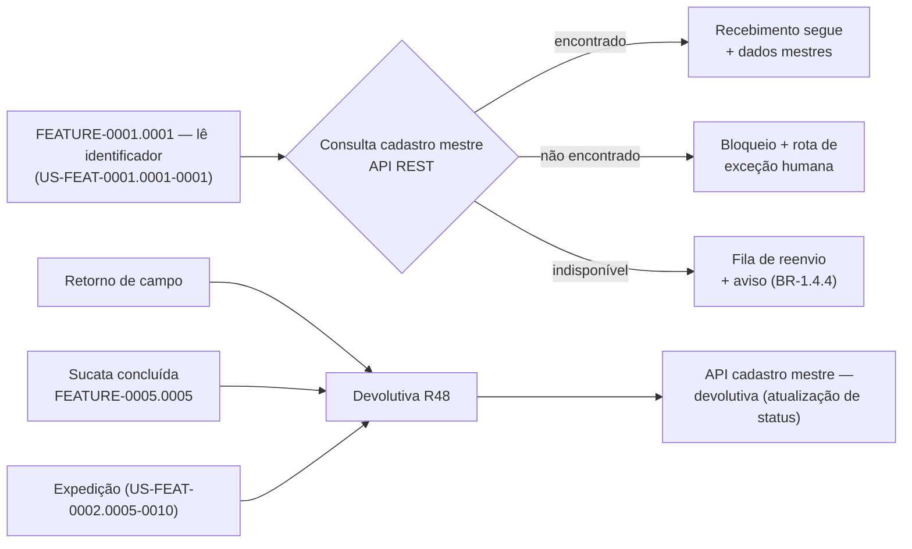

# ✨ FEATURE-0001.0004 — Validação de identificador no cadastro mestre

| Campo | Valor |
|---|---|
| Projeto | PRJ-SUP-2026-0000-RMR (RMR Reversa) |
| Épico | [EPIC-0001 — Logística Reversa e Triagem](../epicos/EPIC-0001-logistica-reversa-e-triagem.md) |
| B-REQ dona | — (nascido de **R17, R22 e R48**) |
| Prioridade | **Onda 2-Should (MVP completo)** (fora da Onda 1-Must (MVP mínimo) — **dependência externa**) — ver [backlog](../../../../docs/produto/backlog/BACKLOG-LIST.md) |
| Requisitos (PEDIDO) | R17 (validar o identificador — NDS/IMEI no pedido — consultando o cadastro mestre), R22 (validar na base do cadastro mestre na triagem), R48 (devolutiva: retornos do campo, sucateados, expedidos) — [PEDIDO](../../prj-negocio/discovery/PEDIDO.md) |
| Depende de | **API REST genérica do cadastro mestre corporativo** (fase 2 — [diretrizes de arquitetura](https://github.com/fbso-techservice/platform-standards/blob/main/standards/architecture/diretrizes-arquitetura.md): API-First, aberta a **qualquer** sistema de ativos — SAP/TOTVS/Senior/Sankhya ou interno) |
| Integra com | **FEATURE-0001.0001** (recebimento — validação) · **FEATURE-0002.0001** (sucata/expedição — devolutiva) |
| User stories | [US-FEAT-0001.0004-0018](../user-stories/US-FEAT-0001.0004-0018-validacao-identificador-cadastro-mestre.md) · [US-FEAT-0001.0004-0019](../user-stories/US-FEAT-0001.0004-0019-devolutiva-desfecho.md) |
| 🔒 Travada por | [PENDENCY-0019](../../pendencias.md) (BR-1.4.4) · [PENDENCY-0020](../../pendencias.md) (fechamento do contrato) |
| Status | 📝 Rascunho (2026-10-16) |

## 1. Objetivo

Garantir que **todo Identificador Físico do Ativo recebido exista no cadastro mestre corporativo** (Sistema Mestre de Materiais Serializados — conceito genérico, qualquer ERP/API) antes de seguir fluxo, e **devolver de volta** ao mestre os desfechos do ciclo (retorno de campo, sucata, expedição) — fechando o ciclo de vida do ativo entre o RMR e a corporação.

## 2. Escopo

### Entra
- **Validação na triagem (R17/R22):** consulta do identificador ao cadastro mestre via API REST genérica no recebimento → sucesso (dados mestres anexados) ou insucesso (rota de exceção humana).
- **Devolutiva de desfecho (R48):** comunicação automática ao cadastro mestre quando o item **retorna do campo**, é **sucateado** ou **expedido**.
- **Resiliência:** indisponibilidade do cadastro mestre não trava a operação — fila de reenvio + aviso (regra derivada, §6).

### Fora
- Watchlist (listas próprias) → **FEATURE-0001.0005** — complementar (FEATURE-0001.0004 = cadastro mestre; FEATURE-0001.0005 = listas de atenção).
- **Fechamento de contrato REST do cadastro mestre** (fora do escopo desta feature) → **✅ especificado (2026-10-21)** em [integracao-cadastro-mestre](../../../../docs/tecnico/arquitetura/integracoes/integracao-cadastro-mestre.md) + [OpenAPI](../../../../docs/tecnico/arquitetura/integracoes/contratos/openapi-cadastro-mestre.yaml) (base TMF, a alinhar a TMF639). O **fechamento com a área dona** segue pendente na **[PENDENCY-0020](../../pendencias.md)**, detalhado no §9 do mesmo doc.

## 3. Regras de negócio

| ID | Regra |
|---|---|
| BR-1.4.1 | Na triagem, o **identificador lido** (US-FEAT-0001.0001-0001 — [catálogo §5.1](../../../../docs/negocio/taxonomia-entidades-cadastro-ativos.md)) é consultado no cadastro mestre antes da conclusão do recebimento (R17/R22) |
| BR-1.4.2 | **Sucesso** = identificador encontrado (+ dados mestres) → recebimento segue; **insucesso** = não encontrado → aviso e **bloqueio do recebimento normal** — segue por rota de exceção com decisão humana registrada |
| BR-1.4.3 | **Devolutiva** (R48) disparada em 3 desfechos: **retorno do campo** (novo recebimento de item já conhecido), **sucateado** (destinação concluída — FEATURE-0005.0005) e **expedido** (US-FEAT-0002.0005-0010) |
| BR-1.4.4 | **cadastro mestre indisponível** não trava a triagem: o registro segue com aviso e entra em **fila de reenvio** — *regra derivada — validar com as áreas* (**[PENDENCY-0019](../../pendencias.md)**) |
| BR-1.4.5 | Toda chamada (sucesso, insucesso, falha, devolutiva) é **auditada**: ator, data/hora, identificador, resultado |
| BR-1.4.6 | A integração é **REST genérica** (API-First) — funciona com **qualquer** sistema que controle ativos, sem amarrar a um fornecedor ([diretrizes](https://github.com/fbso-techservice/platform-standards/blob/main/standards/architecture/diretrizes-arquitetura.md)); **API canônica de referência: TMF639 (Resource Inventory)** para ativos (decisão ✅ 2026-10-21) |
| BR-1.4.7 | A **devolutiva é idempotente** — o reenvio (fila/retry) **não duplica** o registro no cadastro mestre (definição de negócio confirmada 2026-10-21 — [PENDENCY-0014](../../pendencias.md)); a **implementação** (timeout, retry, fila) compõe **TASK técnica** com os **padrões do time técnico** — ajuste fora do padrão só se **FEATURES/US** definirem |
| BR-1.4.8 | **Falha na devolutiva não perde a transição:** o envio que falha vai para a **fila de reenvio** com limite de tentativas; esgotadas as tentativas, dispara **alerta para o suporte** e a devolutiva fica **pendente**, sem bloquear a triagem. Valores e comportamento seguem o **padrão técnico de resiliência** ([integrations §2](../../../../docs/tecnico/arquitetura/integracoes/integrations.md)) *(decisão 2026-10-22)* |

## 4. Fluxo

> ✅ **Pendência resolvida (2026-10-21):** [PENDENCY-0014](../../pendencias.md) respondida — o contrato REST do cadastro mestre alimenta o nó *Consulta API REST* (proposta em [integracao-cadastro-mestre](../../../../docs/tecnico/arquitetura/integracoes/integracao-cadastro-mestre.md); fechamento no §9 do mesmo doc).
> 🟥 **No fluxo, resta [PENDENCY-0019](../../pendencias.md)** (BR-1.4.4): o nó *Fila de reenvio + aviso* continua sendo a **hipótese** a validar com as áreas — decidindo-se bloqueio total com a API indisponível, o nó muda.

## 5. User stories desta feature

| ID | História | AC |
|---|---|---|
| [US-FEAT-0001.0004-0018](../user-stories/US-FEAT-0001.0004-0018-validacao-identificador-cadastro-mestre.md) | Validar identificador no cadastro mestre na triagem | 4 |
| [US-FEAT-0001.0004-0019](../user-stories/US-FEAT-0001.0004-0019-devolutiva-desfecho.md) | Comunicar devolutiva de desfecho ao cadastro mestre | 4 |

## 6. Pendências ⬜ → [hub](../../pendencias.md)

1. ✅ **PENDENCY-0014 — Contrato da API do cadastro mestre:** **respondida em 2026-10-21** — contrato de **saída** (consulta `GET` por `identifierType`/`identifierValue`, com payload 200 e 404) e de **devolutiva** (atualização de status) especificados em **[integracao-cadastro-mestre](../../../../docs/tecnico/arquitetura/integracoes/integracao-cadastro-mestre.md)** + **[OpenAPI](../../../../docs/tecnico/arquitetura/integracoes/contratos/openapi-cadastro-mestre.yaml)** · **API canônica: TMF639** (Resource Inventory) para ativos · idempotência da devolutiva = regra de negócio (**BR-1.4.7**) com implementação em TASK técnica · ACL formalizado (**[ADR-004](../../../../docs/tecnico/arquitetura/adrs/adr-004-acl-outbox.md)** + [integrations](../../../../docs/tecnico/arquitetura/integracoes/integrations.md)) · timeout/retry/fila: padrões do time técnico, ajuste só por regra em FEATURES/US.
2. ⬜ **PENDENCY-0019 — BR-1.4.4 (regra derivada):** validar com as áreas que recebimento pode prosseguir com validação pendente (fila) ou se a indisponibilidade bloqueia tudo.
3. ⬜ **PENDENCY-0020 — Fechamento do contrato do cadastro mestre com a área dona:** aderência aos schemas TMF639, mapeamento dos desfechos da BR-1.4.3 para o status do mestre, URL base, escopos OAuth2 e catálogo de status (residual da ✅ PENDENCY-0014). Dono: Eng + área dona do cadastro mestre. Prazo: 2026-11-07. Detalhe: [integracao-cadastro-mestre §9](../../../../docs/tecnico/arquitetura/integracoes/integracao-cadastro-mestre.md) · [checklist de integrações](../../../../docs/tecnico/arquitetura/integracoes/checklist-fechamento-integracoes.md).

## 7. Critérios de aceite da feature (definition of done)

- [ ] Todo identificador lido na triagem passa pela consulta ao cadastro mestre (sucesso/insucesso registrado).
- [ ] Insucesso e indisponibilidade têm comportamentos **distintos e auditados** (bloqueio × fila).
- [ ] Os 3 desfechos (retorno, sucata, expedição) disparam devolutiva ao cadastro mestre.
- [ ] Zero amarração a ERP específico — API REST genérica (BR-1.4.6).
