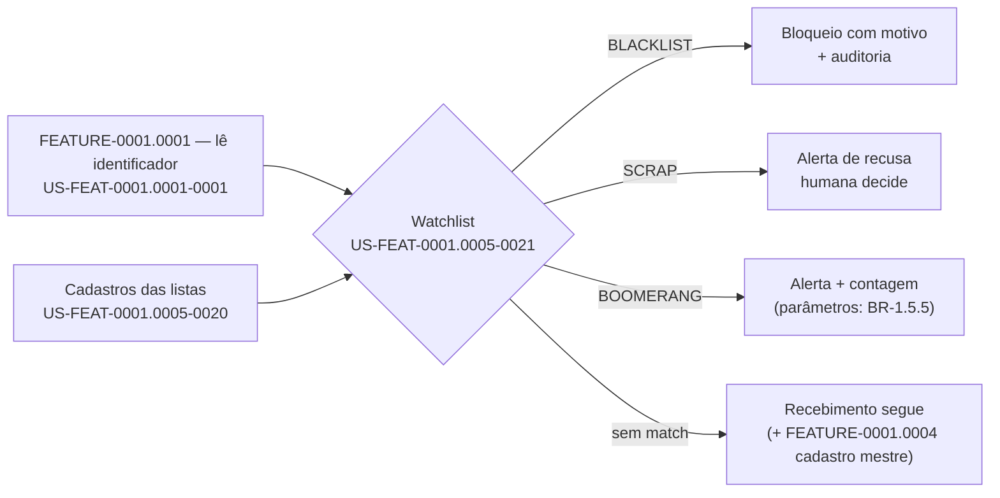

# ✨ FEATURE-0001.0005 — Watchlist de triagem (blacklist / scrap / boomerang)

| Campo | Valor |
|---|---|
| Projeto | PRJ-SUP-2026-0000-RMR (RMR Reversa) |
| Épico | [EPIC-0001 — Logística Reversa e Triagem](../epicos/EPIC-0001-logistica-reversa-e-triagem.md) |
| B-REQ dona | — (nascido de **R19 e R23** — decisão **PENDENCY-0001**) |
| Prioridade | **Onda 2-Should (MVP completo)** (fora da Onda 1-Must (MVP mínimo)) — MVP Core do [BRAINSTORM §4.2](../discovery/BRAINSTORM.md) · [decisão D-07](../backlog/DECISOES-BACKLOG.md) |
| Requisitos (PEDIDO) | R19 (cadastro de blacklists), R23 (validar o identificador — NDS/IMEI no pedido — em blacklist, scrap ou boomerang na triagem) — [PEDIDO](../../prj-negocio/discovery/PEDIDO.md) |
| Integra com | **FEATURE-0001.0001** (recebimento — validação na leitura, US-FEAT-0001.0001-0001) · **FEATURE-0001.0004** (complementar: FEATURE-0001.0004 = cadastro mestre; FEATURE-0001.0005 = listas de atenção) |
| User stories | [US-FEAT-0001.0005-0020](../user-stories/US-FEAT-0001.0005-0020-cadastro-watchlist.md) · [US-FEAT-0001.0005-0021](../user-stories/US-FEAT-0001.0005-0021-validacao-watchlist-triagem.md) |
| 🔒 Travada por | — (livre) |
| Status | 📝 Rascunho (2026-10-16) |

## 1. Objetivo

Manter **listas de atenção** consultadas em cada recebimento, para que a triagem **identifique, recuse ou destaque** ativos com particularidade — black list (identificar), scrap (não aceitar) e boomerang (retorno recorrente) — antes que sigam fluxo.

## 2. Escopo

### Entra
- **Cadastro das listas (R19):** entrada por identificador + lista + motivo + autor + data; consulta e desativação.
- **Validação na triagem (R23):** o identificador lido ([catálogo §5.1](../../../../docs/negocio/taxonomia-entidades-cadastro-ativos.md)) passa pela watchlist → **bloqueio** (blacklist), **alerta de recusa** (scrap), **alerta com contagem de retornos** (boomerang).
- **Contagem de retornos** por identificador alimenta o alerta de boomerang (duas checagens independentes — parâmetros na **BR-1.5.5**).

### Fora
- Consulta no cadastro mestre corporativo → **FEATURE-0001.0004** · Watchlist automática por decisão de motor → FEATURE-0001.0002 (Onda 2-Should (MVP completo)) — aqui a decisão continua humana.

## 3. Regras de negócio

| ID | Regra |
|---|---|
| BR-1.5.1 | Watchlist = **3 listas**: `BLACKLIST` (identificar particularidade — R19), `SCRAP` (não aceitar), `BOOMERANG` (retorno recorrente — R23) |
| BR-1.5.2 | Toda entrada registra: **identificador, lista, motivo, autor e data**; entrada nunca é excluída — **desativada** com trilha (R19) |
| BR-1.5.3 | A validação acontece na **leitura do identificador** do recebimento (US-FEAT-0001.0001-0001) — **antes** de concluir a entrada do item (R23) |
| BR-1.5.4 | `BLACKLIST` → **bloqueio** do recebimento com motivo; `SCRAP` → **alerta de recusa** (operador confirma recusa ou prossegue com registro); `BOOMERANG` → **alerta** com contagem de retornos no período — sempre **decisão humana** auditada |
| BR-1.5.5 | Boomerang é alimentado por **contagem automática de retornos** do identificador, em **janela móvel de dias corridos**, com **duas checagens independentes exibidas juntas** (decisão ✅ [PENDENCY-0013](../../pendencias.md) — 2026-10-21): **≥ 2 retornos em 30 dias corridos** e **≥ 4 retornos em 90 dias corridos** — as duas aparecem no alerta quando atendidas; **nenhuma delas bloqueia** (bloqueio é só da BLACKLIST — BR-1.5.4) |
| BR-1.5.6 | Toda tentativa **bloqueada ou alertada** fica na trilha de auditoria (ator, data/hora, identificador, lista, ação) |
| BR-1.5.7 | Watchlist e cadastro mestre (FEATURE-0001.0004) são **complementares** — as duas checagens rodam no recebimento, independentemente |

## 4. Fluxo

> ✅ **Pendência resolvida (2026-10-21):** [PENDENCY-0013](../../pendencias.md) respondida — o nó *Alerta + contagem* usa os parâmetros definidos com a Operação (duas checagens independentes, exibidas juntas — valores na **BR-1.5.5**).

## 5. User stories desta feature

| ID | História | AC |
|---|---|---|
| [US-FEAT-0001.0005-0020](../user-stories/US-FEAT-0001.0005-0020-cadastro-watchlist.md) | Cadastrar e gerenciar a watchlist | 3 |
| [US-FEAT-0001.0005-0021](../user-stories/US-FEAT-0001.0005-0021-validacao-watchlist-triagem.md) | Validar o identificador na triagem contra a watchlist | 5 |

## 6. Pendências ✅ resolvidas → [hub](../../pendencias.md)

1. ✅ **PENDENCY-0013 — Parâmetros do boomerang:** **respondida em 2026-10-21** com a Operação — duas checagens independentes exibidas juntas, sem bloqueio automático (decisão humana auditada); parâmetros e janela móvel de dias corridos: **BR-1.5.5**.

## 7. Critérios de aceite da feature (definition of done)

- [ ] Listas cadastráveis (entrada com motivo/autor/data) e sem exclusão dura.
- [ ] Todo recebimento passa pela checagem: blacklist bloqueia, scrap alerta, boomerang destaca a contagem.
- [ ] Toda ação humana sobre alerta/bloqueio é auditada.
- [ ] Funciona **sem mouse** (leitor/atalhos) e **sem sistemas externos** (listas são internas — compatível com a Onda 1-Must (MVP mínimo) se priorizada depois).
