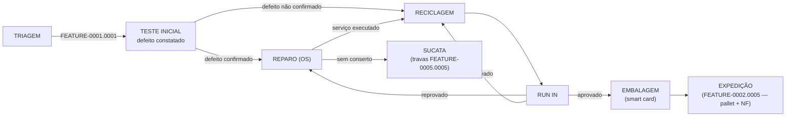

# ✨ FEATURE-0002.0001 — Painel Kanban de operação do workflow (etapas do conserto)

| Campo | Valor |
|---|---|
| Projeto | PRJ-SUP-2026-0000-RMR (RMR Reversa) |
| Épico | [EPIC-0002 — Oficina de Manutenção (Workflow)](../epicos/EPIC-0002-oficina-de-manutencao-workflow.md) |
| B-REQ dona | — (nascido do **workflow R20**; suporte a todo o fluxo da Onda 1-Must (MVP mínimo)) |
| Prioridade | **Onda 1-Must (MVP mínimo)** (Sprint 2) — ver [escopo da Onda 1-Must (MVP mínimo)](../escopo-onda-1.md) |
| Requisitos (PEDIDO) | R20, R26–R33, R35 (+ R7 como referência do teste inicial) — [PEDIDO](../../prj-negocio/discovery/PEDIDO.md) *(R36/R37 — expedição — migraram para a **[FEATURE-0002.0005](FEATURE-0002.0005-expedicao.md)**, decisão PENDENCY-0004)* |
| Depende de | **FEATURE-0001.0001** (item já recebido em TRIAGEM) · integra com **FEATURE-0005.0005** (sucata) e **FEATURE-0002.0002** (etiquetas — fora da Onda 1-Must (MVP mínimo)) |
| Fora desta feature | **Expedição → [FEATURE-0002.0005](FEATURE-0002.0005-expedicao.md)** · Etiquetas → FEATURE-0002.0002 · Buscas → FEATURE-0002.0003 · Dashboards → FEATURE-0002.0004 · Catálogos completos → FEATURE-0001.0003 |
| User stories | [US-FEAT-0002.0001-0004](../user-stories/US-FEAT-0002.0001-0004-painel-kanban.md) · [US-FEAT-0002.0001-0005](../user-stories/US-FEAT-0002.0001-0005-teste-inicial.md) · [US-FEAT-0002.0001-0006](../user-stories/US-FEAT-0002.0001-0006-reparo-os.md) · [US-FEAT-0002.0001-0007](../user-stories/US-FEAT-0002.0001-0007-reciclagem.md) · [US-FEAT-0002.0001-0008](../user-stories/US-FEAT-0002.0001-0008-run-in.md) · [US-FEAT-0002.0001-0009](../user-stories/US-FEAT-0002.0001-0009-embalagem.md) *(US-FEAT-0002.0005-0010 migrou para a [FEATURE-0002.0005](FEATURE-0002.0005-expedicao.md))* |
| 🔒 Travada por | [ENABLER-0001](../../prj-tecnico/enablers/ENABLER-0001-servidor-interno-docker-compose.md) · [ENABLER-0003](../../prj-tecnico/enablers/ENABLER-0003-keycloak-perfis.md) · [ENABLER-0004](../../prj-tecnico/enablers/ENABLER-0004-policies-rls-tenant.md) · [ENABLER-0005](../../prj-tecnico/enablers/ENABLER-0005-flyway-entidades-seeds.md) · [ENABLER-0006](../../prj-tecnico/enablers/ENABLER-0006-workflow-tabela-configuracao.md) · [ENABLER-0007](../../prj-tecnico/enablers/ENABLER-0007-auditoria-append-only.md) · [ENABLER-0008](../../prj-tecnico/enablers/ENABLER-0008-terminais-leitores.md) · [ENABLER-0009](../../prj-tecnico/enablers/ENABLER-0009-decisao-stack-front.md) |
| Status | 📝 Rascunho (2026-10-16) |

## 1. Objetivo

Dar ao time da oficina (e operadores das etapas finais) **um único painel** para ver os itens por etapa e **operar todas as transições do workflow** da Onda 1-Must (MVP mínimo) — `TRIAGEM → TESTE INICIAL → REPARO → RECICLAGEM → RUN IN → EMBALAGEM → EXPEDIÇÃO` (+ sucata) — com auditoria por etapa.

> 💡 **Nota de escopo:** o título original ("controle do status do conserto pelos técnicos") foi ampliado para **operação do workflow completo**, porque a definição do [Onda 1-Must (MVP mínimo)](../backlog/BACKLOG-LIST.md) exige que o item percorra **todas** as etapas e nenhuma outra feature do mapeamento é dona delas (R26–R35). A **expedição (R36/R37) foi extraída para a [FEATURE-0002.0005](FEATURE-0002.0005-expedicao.md)** — decisão da Operação/PO em 2026-10-16 (PENDENCY-0004).

## 2. Escopo

### Entra
- **Painel Kanban** com colunas = etapas do workflow da Onda 1-Must (MVP mínimo); cartão = item (identificador, modelo, defeito reclamado, tempo na etapa) — atualização por **polling** no MVP (BRAINSTORM §6.7).
- **Transições operadas por teclado/atalhos** (terminal + leitor, sem mouse).
- **Etapa Teste Inicial:** defeito constatado + rota (reparo × reciclagem) — R26/R27.
- **Etapa Reparo:** OS completa + destino (reciclagem × sucata/sem conserto) — R28/R29.
- **Etapa Reciclagem:** serviço cosmético + operador — R30/R31.
- **Etapa Run in:** aprovação/reprovação com retorno a reparo/reciclagem — R32.
- **Etapa Embalagem:** operador, data/hora, smart card + identificador do item juntos — R33/R35.
- **Pré-condições de transição** validadas em **um único ponto** (BRAINSTORM §8).

### Fora
- **Expedição (R36/R37 — pallet + NF)** → **[FEATURE-0002.0005](FEATURE-0002.0005-expedicao.md)** *(extraída em 2026-10-16 — decisão PENDENCY-0004)*.
- Etiqueta final na embalagem (R34) → **FEATURE-0002.0002** (*Onda 1-Must (MVP mínimo) opera sem etiqueta — **confirmado** com a Operação em 2026-10-16*).
- Cálculo automático de rota → **FEATURE-0001.0002** (motor é Onda 2-Should (MVP completo); Onda 1-Must (MVP mínimo) é decisão humana).

## 3. Regras de negócio

| ID | Regra |
|---|---|
| BR-2.1.1 | O painel exibe sete colunas, uma por etapa da Onda 1-Must (MVP mínimo); EXPEDIÇÃO é somente leitura; SUCATA aparece como ramo, indicador ou filtro, sem coluna própria; cada cartão mostra identificador, modelo, defeito reclamado e tempo de permanência na etapa |
| BR-2.1.2 | Toda transição registra **ator, data/hora, local e identificador lido** (R20) — inclusive tentativas bloqueadas |
| BR-2.1.3 | Pré-condições por etapa (ex.: só expede se passou por run in; só repara com defeito constatado) validadas em **um único ponto** do motor |
| BR-2.1.4 | **Teste inicial:** exige defeito constatado (R26); rota para **reparo** (com defeito) ou **reciclagem** (R27) — decisão **humana** na Onda 1-Must (MVP mínimo) |
| BR-2.1.5 | **Reparo:** OS com técnico, início/fim, defeito constatado, local danificado, componente, causa raiz e serviço/motivo (R28). Serviço executado → **reciclagem**; **sem conserto** → **sucata** com travas **FEATURE-0005.0005** (R29) |
| BR-2.1.6 | **Reciclagem:** registra serviço cosmético, data/hora e operador (R30) → avança para **run in** (R31) |
| BR-2.1.7 | **Run in:** aprovado → **embalagem**; reprovado → volta a **reparo** ou **reciclagem** (R32) — escolha humana |
| BR-2.1.8 | **Embalagem:** registra operador, data/hora (R33) e o **smart card + identificador embalados juntos** (R35) → **expedição** |
| BR-2.1.9 | *(migrada)* Expedição/pallet/NF → agora **BR-2.5.1/2.5.2** na **[FEATURE-0002.0005](FEATURE-0002.0005-expedicao.md)** — decisão PENDENCY-0004 (2026-10-16) |
| BR-2.1.10 | Navegação e transições **sem mouse** (atalhos/teclado — BRAINSTORM §6.7); painel atualiza por **polling** (§6.7) |
| BR-2.1.11 | No Onda 1-Must (MVP mínimo) o fluxo é **fixo e mínimo** (1 modelo) — permissões por defeito (R14) e níveis por fornecedor (R18) ficam para Onda 2-Should (MVP completo) (pendência §6) |

## 4. Fluxo

## 5. User stories desta feature

| ID | História | AC |
|---|---|---|
| [US-FEAT-0002.0001-0004](../user-stories/US-FEAT-0002.0001-0004-painel-kanban.md) | Ver painel por etapa | 3 |
| [US-FEAT-0002.0001-0005](../user-stories/US-FEAT-0002.0001-0005-teste-inicial.md) | Operar teste inicial | 3 |
| [US-FEAT-0002.0001-0006](../user-stories/US-FEAT-0002.0001-0006-reparo-os.md) | Abrir OS no reparo | 4 |
| [US-FEAT-0002.0001-0007](../user-stories/US-FEAT-0002.0001-0007-reciclagem.md) | Registrar reciclagem | 3 |
| [US-FEAT-0002.0001-0008](../user-stories/US-FEAT-0002.0001-0008-run-in.md) | Aprovar/reprovar run in | 3 |
| [US-FEAT-0002.0001-0009](../user-stories/US-FEAT-0002.0001-0009-embalagem.md) | Registrar embalagem | 3 |

> US-FEAT-0002.0005-0010 (expedição) migrou para a **[FEATURE-0002.0005](FEATURE-0002.0005-expedicao.md)**.

## 6. Pendências ✅/❌ encerradas → [hub](../../pendencias.md)

1. ❌ **PENDENCY-0003 — R14** (permissões de serviço conforme defeito) e **R18** (níveis de reparo por fornecedor): configuração de workflow/catálogo — Onda 1-Must (MVP mínimo) usa fluxo fixo; detalhar em Onda 2-Should (MVP completo) (retomada da [PENDENCY-0003](../../pendencias.md) — [ADR-003](../../../../docs/tecnico/arquitetura/adrs/adr-003-workflow-configuravel.md)). **(Adiada)**
2. ✅ **PENDENCY-0004** — expedição **extraída para [FEATURE-0002.0005](FEATURE-0002.0005-expedicao.md)** (2026-10-16).
3. ✅ **PENDENCY-0005** — Onda 1-Must (MVP mínimo) **embala sem etiqueta** confirmado (identificação por leitura + smart card).
4. ✅ **PENDENCY-0006** — **smart card com registro manual** auditado na Onda 1-Must (MVP mínimo) confirmado.

## 7. Critérios de aceite da feature (definition of done)

- [ ] Um item percorre **todas as etapas sob esta feature** (TRIAGEM → TESTE INICIAL → REPARO → RECICLAGEM → RUN IN → EMBALAGEM) via painel, com transição auditada em cada passo (quem/quando/onde) — expedição é da **FEATURE-0002.0005**.
- [ ] Pré-condições bloqueiam avanços inválidos (ex.: embalagem sem run in aprovado).
- [ ] Rota de sucata (sem conserto e run in reprovado quando aplicável) exige as travas da **FEATURE-0005.0005**.
- [ ] Operação completa **sem mouse** (teclado/leitor) e painel atualiza sozinho (polling).
- [ ] Zero dependência de sistemas externos (pré-requisito da Onda 1-Must (MVP mínimo)).
