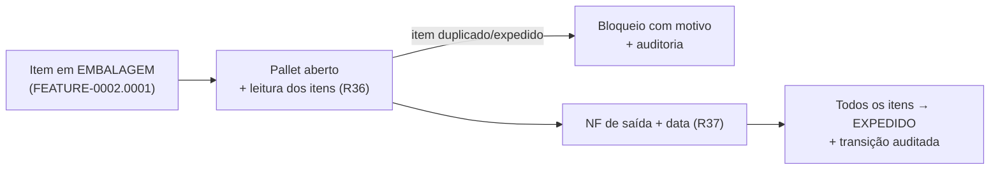

# ✨ FEATURE-0002.0005 — Expedição (pallet por leitura + NF de saída)

| Campo | Valor |
|---|---|
| Projeto | PRJ-SUP-2026-0000-RMR (RMR Reversa) |
| Épico | [EPIC-0002 — Oficina de Manutenção (Workflow)](../epicos/EPIC-0002-oficina-de-manutencao-workflow.md) |
| B-REQ dona | — (etapa final do workflow R20) |
| Prioridade | **Onda 1-Must (MVP mínimo)** *(extraída da FEATURE-0002.0001 — decisão **PENDENCY-0004**, 2026-10-16)* |
| Requisitos (PEDIDO) | R36 (pallet por leitura), R37 (NF de saída + data) — [PEDIDO](../../prj-negocio/discovery/PEDIDO.md) |
| Origem | Escopo **movido da [FEATURE-0002.0001](FEATURE-0002.0001-painel-kanban-workflow.md)** — decisão no [checklist Operação/PO §B1](../backlog/checklist-operacao-po-onda-1.md) |
| Depende de | **FEATURE-0002.0001** (item em EMBALAGEM) · a futura **FEATURE-0005.0006** (baixa patrimonial, Onda 2-Should (MVP completo)) |
| User stories | [US-FEAT-0002.0005-0010](../user-stories/US-FEAT-0002.0005-0010-expedicao.md) *(migrou da FEATURE-0002.0001)* |
| 🔒 Travada por | [ENABLER-0001](../../prj-tecnico/enablers/ENABLER-0001-servidor-interno-docker-compose.md) · [ENABLER-0003](../../prj-tecnico/enablers/ENABLER-0003-keycloak-perfis.md) · [ENABLER-0004](../../prj-tecnico/enablers/ENABLER-0004-policies-rls-tenant.md) · [ENABLER-0005](../../prj-tecnico/enablers/ENABLER-0005-flyway-entidades-seeds.md) · [ENABLER-0007](../../prj-tecnico/enablers/ENABLER-0007-auditoria-append-only.md) · [ENABLER-0008](../../prj-tecnico/enablers/ENABLER-0008-terminais-leitores.md) · [ENABLER-0009](../../prj-tecnico/enablers/ENABLER-0009-decisao-stack-front.md) |
| Status | 📝 Rascunho (2026-10-16) |

## 1. Objetivo

Compor o **pallet de expedição** lendo os itens um a um e fechar a saída com **NF** — a etapa final da Onda 1-Must (MVP mínimo) em **feature própria**, para evoluir (pallets complexos, reconciliação) sem mexer no motor do workflow.

## 2. Escopo

### Entra
- **Pallet por leitura (R36):** abertura do pallet + leitura dos identificadores; lista mostra todos os identificadores que o compõem.
- **NF de saída + data (R37):** conclusão move **todos** os itens do pallet para EXPEDIDO.
- **Bloqueio de duplicidade:** item já expedido ou em outro pallet/processo ativo não entra (BR-2.5.3 — confirmada no [checklist C2](../backlog/checklist-operacao-po-onda-1.md)).
- Auditoria por ação (ator, data/hora, identificador).

### Fora
- Etiqueta final (R34) → **FEATURE-0002.0002** · Reconciliação de expedição → evolução futura · Baixa patrimonial → **FEATURE-0005.0006** (Onda 2-Should (MVP completo)).

## 3. Regras de negócio

| ID | Regra |
|---|---|
| BR-2.5.1 | O pallet é composto pela **leitura dos identificadores** (bipando item a item — R36); a lista do pallet exibe todos os identificadores |
| BR-2.5.2 | A conclusão exige **NF de saída + data** (R37) e move **todos** os itens do pallet para **EXPEDIDO**, com transição auditada |
| BR-2.5.3 | Item **já expedido** ou pertencente a **outro pallet/processo ativo** → leitura **bloqueada** com motivo — *regra confirmada com as áreas em 2026-10-16 ([checklist C2](../backlog/checklist-operacao-po-onda-1.md))* |
| BR-2.5.4 | Operação **por leitor + teclado**, sem mouse (leitura em lote) |
| BR-2.5.5 | Toda tentativa **bloqueada** fica na trilha de auditoria |

## 4. Fluxo

> **Integração futura (Onda 2-Should (MVP completo)):** a devolutiva "expedido" ao cadastro mestre (R48) entra com a FEATURE-0001.0004 e não é pré-requisito da Onda 1-Must (MVP mínimo).

## 5. User stories desta feature

| ID | História | AC |
|---|---|---|
| [US-FEAT-0002.0005-0010](../user-stories/US-FEAT-0002.0005-0010-expedicao.md) | Compor o pallet e expedir os itens | 4 |

## 6. Pendências

> Nenhuma aberta — as pendências originais do escopo de expedição foram resolvidas no [checklist Operação/PO](../backlog/checklist-operacao-po-onda-1.md) (PENDENCY-0004/PENDENCY-0005/PENDENCY-0006/PENDENCY-0009 ✅).

**Nota de evolução:** se crescer o volume (pallets múltiplos, reconciliação, coleta fracionada), reavaliar o escopo — a extração da FEATURE-0002.0001 já deu a autonomia necessária.

## 7. Critérios de aceite da feature (definition of done)

- [ ] Pallet composto **por leitura**, com lista de identificadores conferível.
- [ ] Sem **NF**, não há expedição — e com NF, **todos** os itens do pallet são expedidos auditados.
- [ ] Item duplicado/expedido é **bloqueado com motivo** e a tentativa fica na trilha.
- [ ] Transição para EXPEDIDO registrada e auditada.
- [ ] Operação **sem mouse** (leitor em lote).
