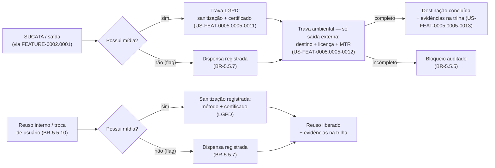

# ✨ FEATURE-0005.0005 — Travas de LGPD e compliance ambiental (saída do ativo)

| Campo | Valor |
|---|---|
| Projeto | PRJ-SUP-2026-0000-RMR (RMR Reversa) |
| Épico | [EPIC-0005 — Recuperação de Valor](../epicos/EPIC-0005-recuperacao-de-valor.md) |
| B-REQ dona | **B-REQ-05** (Termo de Destruição Segura de Dados — LGPD) |
| Prioridade | **Onda 1-Must (MVP mínimo)** (mínimo: registro do certificado) — ver [escopo da Onda 1-Must (MVP mínimo)](../escopo-onda-1.md) |
| Requisitos (PEDIDO) | R12 (serviço no HDD), R13 (serviços de reciclagem) · contexto [BRAINSTORM §2.6](../discovery/BRAINSTORM.md) · [PEDIDO](../../prj-negocio/discovery/PEDIDO.md) |
| Depende de | Fluxo entregue por **FEATURE-0001.0001 + FEATURE-0002.0001** (trava aciona nas rotas de saída) |
| Reutilizada por | **FEATURE-0005.0004** (venda — Onda 3-Could (Integração & Valor)): as mesmas travas são exigidas antes de qualquer venda, sem retrabalho |
| User stories | [US-FEAT-0005.0005-0011](../user-stories/US-FEAT-0005.0005-0011-destruicao-dados-midia.md) · [US-FEAT-0005.0005-0012](../user-stories/US-FEAT-0005.0005-0012-compliance-ambiental-destino.md) · [US-FEAT-0005.0005-0013](../user-stories/US-FEAT-0005.0005-0013-evidencias-compliance-auditoria.md) |
| 🔒 Travada por | [ENABLER-0001](../../prj-tecnico/enablers/ENABLER-0001-servidor-interno-docker-compose.md) · [ENABLER-0003](../../prj-tecnico/enablers/ENABLER-0003-keycloak-perfis.md) · [ENABLER-0004](../../prj-tecnico/enablers/ENABLER-0004-policies-rls-tenant.md) · [ENABLER-0005](../../prj-tecnico/enablers/ENABLER-0005-flyway-entidades-seeds.md) · [ENABLER-0007](../../prj-tecnico/enablers/ENABLER-0007-auditoria-append-only.md) · [ENABLER-0009](../../prj-tecnico/enablers/ENABLER-0009-decisao-stack-front.md) |
| Status | 📝 Rascunho (2026-10-16) |

## 1. Objetivo

**Nenhum ativo sai do fluxo sem prova.** Bloquear a conclusão de qualquer rota de saída (sucata → destinação) até que estejam registrados: **(a) sanitização segura de dados da mídia** (wipe lógico ou destruição física; LGPD — B-REQ-05) quando aplicável, e **(b) compliance ambiental do destino** (PNRS — reciclador licenciado/MTR). É a trava da Onda 1-Must (MVP mínimo) — e a mesma trava valerá para a venda em FEATURE-0005.0004.

## 2. Escopo

### Entra
- **Trava LGPD:** exigência de sanitização por **wipe lógico ou destruição física** + **certificado anexado ao item** (tipo de mídia, método, responsável, data/hora, arquivo do termo) antes da saída (B-REQ-05).
- **Flag de mídia por modelo/categoria** (possui HD/SSD ou não) — na Onda 1-Must (MVP mínimo), atributo do modelo da Onda 1-Must (MVP mínimo) (FEATURE-0001.0003 assume o catálogo em Onda 2-Should (MVP completo)).
- **Trava ambiental:** registro do destino — reciclador + **número da licença** + **MTR** (PNRS) — processo em [regras-mtr-pnrs](../../../../docs/negocio/regras-mtr-pnrs.md).
- **Bloqueio duro** com tentativa auditada na trilha do item + evidências consultáveis (prova para Jurídico/Compliance).

### Fora
- Emissão/integração do MTR em sistema ambiental → **decidido**: manual na Onda 1-Must (MVP mínimo); integração é evolução pós-Onda 1-Must (MVP mínimo) (§6, item 1).
- Venda (catálogo/NF) → **FEATURE-0005.0004** (Onda 3-Could (Integração & Valor)) — mas **reutiliza** estas travas.
- Classificação de condição/garantia de peças → FEATURE-0005.0001/FEATURE-0005.0002 (Onda 2-Should (MVP completo)).

## 3. Regras de negócio

| ID | Regra |
|---|---|
| BR-5.5.1 | Item com **mídia de armazenamento** não completa rota de saída sem **sanitização registrada + certificado anexado** (B-REQ-05) |
| BR-5.5.2 | O certificado registra: tipo de mídia, método (**wipe lógico ou destruição física**), responsável, data/hora e o **termo em PDF assinado** *(formato decidido no [checklist A1](../../prj-negocio/requisitos/checklist-juridico-compliance.md))*. A destruição física é um dos métodos aceitos, não o único. |
| BR-5.5.3 | O modelo/categoria do ativo indica se **possui mídia** (flag) — Onda 1-Must (MVP mínimo): atributo do modelo da Onda 1-Must (MVP mínimo) |
| BR-5.5.4 | Saída para reciclagem externa/descarte exige **destino ambiental** registrado: reciclador + nº de licença, **MTR** (PNRS) — MTR **registrado manualmente** na Onda 1-Must (MVP mínimo) *(decidido no [checklist B1](../../prj-negocio/requisitos/checklist-juridico-compliance.md))* |
| BR-5.5.5 | O bloqueio é **duro**: sem LGPD (se aplicável) + ambiental, a transição de saída é impedida e a **tentativa fica na auditoria** |
| BR-5.5.6 | Certificados e registros ficam **anexados à trilha do item** — prova auditável para Jurídico/Compliance/ESG |
| BR-5.5.7 | **Itens sem mídia:** a dispensa é registrada via flag do modelo (sem certificado) — *regra derivada, **confirmada** no [checklist A4](../../prj-negocio/requisitos/checklist-juridico-compliance.md)* |
| BR-5.5.8 | A **venda (FEATURE-0005.0004, Onda 3-Could (Integração & Valor))** exige as **mesmas travas** antes de qualquer oferta — mesmo mecanismo, sem retrabalho |
| BR-5.5.9 | **Perfil Compliance (`PERFIL-COMPLIANCE`)** é o único que registra a sanitização e anexa o certificado; terceiro especializado fica para evolução pós-Onda 1-Must (MVP mínimo) *(decidido no [checklist A2](../../prj-negocio/requisitos/checklist-juridico-compliance.md))* |
| BR-5.5.10 | **Sanitização obrigatória antes de QUALQUER realocação** — saída externa **ou reuso interno/troca de usuário** (B-REQ-03): risco LGPD de dado de usuário anterior *(LC de escopo da Onda 1-Must (MVP mínimo) — decidido no [checklist A3](../../prj-negocio/requisitos/checklist-juridico-compliance.md))* |
| BR-5.5.11 | A **licença do reciclador** registra nº **e validade** no ato da destinação; licença **vencida bloqueia** o destino *(regra proposta, aceita no [checklist B2](../../prj-negocio/requisitos/checklist-juridico-compliance.md))* |
| BR-5.5.12 | Toda **destinação externa** (reciclagem externa ou descarte) exige **MTR** registrado no ato (nº digitado manualmente na Onda 1-Must (MVP mínimo)); sem destino + licença + MTR a saída não conclui (BR-5.5.5). Processo, escopo e exceções: [regras-mtr-pnrs](../../../../docs/negocio/regras-mtr-pnrs.md) *(decisão 2026-10-22)* |

## 4. Fluxo

## 5. User stories desta feature

| ID | História | AC |
|---|---|---|
| [US-FEAT-0005.0005-0011](../user-stories/US-FEAT-0005.0005-0011-destruicao-dados-midia.md) | Certificar a sanitização da mídia (LGPD) | 4 |
| [US-FEAT-0005.0005-0012](../user-stories/US-FEAT-0005.0005-0012-compliance-ambiental-destino.md) | Registrar compliance ambiental do destino (PNRS) | 4 |
| [US-FEAT-0005.0005-0013](../user-stories/US-FEAT-0005.0005-0013-evidencias-compliance-auditoria.md) | Consultar evidências de compliance do item | 3 |

## 6. Pendências ⬜ → ✅ resolvidas (2026-10-16)

> ✅ **Todas decididas** no [checklist de reunião com Jurídico/Compliance](../../prj-negocio/requisitos/checklist-juridico-compliance.md) (7/7 respondidas) — decisões incorporadas nas regras §3 acima.

| # | Pendência (histórico) | Decisão (2026-10-16) |
|---|---|---|
| 1 | MTR: manual × integração | **Manual na Onda 1-Must (MVP mínimo)** (BR-5.5.4); integração é evolução |
| 2 | Formato do certificado | **Upload de PDF assinado** (BR-5.5.2) |
| 3 | Quem executa/assina a sanitização | **Interno, perfil Compliance (`PERFIL-COMPLIANCE`)** (BR-5.5.9) |
| 4 | Flag de mídia por modelo | Onda 1-Must (MVP mínimo): atributo do modelo único; catálogo com FEATURE-0001.0003 em Onda 2-Should (MVP completo) |
| 5 | Escopo da sanitização no **reuso interno** ⚠️ | **Exigir na Onda 1-Must (MVP mínimo)** — sanitização antes de qualquer realocação (BR-5.5.10) — **LC de escopo** |
| 6 | Retenção de evidências | **Guarda padrão na Onda 1-Must (MVP mínimo)**; política de prazos = follow-up pós-Onda 1-Must (MVP mínimo) |
| 7 | Validade da licença do reciclador | **Regra aceita** — nº + validade; vencida bloqueia (BR-5.5.11) |

**Follow-ups pós-Onda 1-Must (MVP mínimo) → [hub PENDENCY-0007, PENDENCY-0008](../../pendencias.md):** política de retenção (Jurídico) · terceiro especializado em sanitização (Compliance).

## 7. Critérios de aceite da feature (definition of done)

- [ ] Nenhum item com mídia completa a rota de sucata/destinação **sem** certificado anexado.
- [ ] **Reuso interno/troca de usuário** de item com mídia também exige sanitização registrada (BR-5.5.10).
- [ ] Nenhum item completa a destinação **sem** destino ambiental registrado (reciclador licenciado **com licença válida** e **MTR**).
- [ ] Tentativas de saída bloqueadas ficam na trilha de auditoria.
- [ ] Evidências consultáveis no próprio item (US-FEAT-0005.0005-0013) — prova para auditoria.
- [ ] Sem sistemas externos na Onda 1-Must (MVP mínimo) (pré-requisito) e operação sem mouse.
