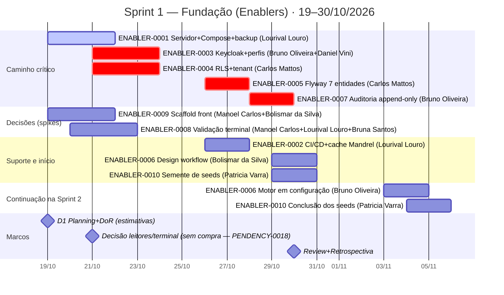

# 🗓️ Sprint 1 — Fundação (Enablers) · 19/10 – 30/10/2026

> **Sprint de preparação pura:** 100% da capacidade em Enablers — nenhuma feature de negócio entra. Objetivo: ao final da sprint, **toda a base técnica da Onda 1-Must (MVP mínimo) existir e estar validada**, para que as stories 0001–0013 comecem na Sprint 2 (02/11) sem retrabalho. Regras: [guia ágil §3–§4](https://github.com/fbso-techservice/platform-standards/blob/main/standards/process/guia-invest-enablers-spike.md) · [template de documento de Enabler](https://github.com/fbso-techservice/platform-standards/blob/main/standards/process/template-enabler-dor.md) · [inventário dos Enablers](#1-inventário-dos-enablers).

| Campo | Valor |
|---|---|
| **Período** | 2026-10-19 (seg) → 2026-10-30 (sex) — **10 dias úteis** (semana 1: 19–23 · semana 2: 26–30) |
| **Foco** | **Enablers exclusivamente** (decisão do PO — opção (c) refinada, ver [§2](#2-análise-das-possibilidades--corte)) |
| **Capacidade** | Time completo (8 papéis — [equipe §3.1](../../equipe.md)) · núcleo de execução: Bruno Oliveira (backend) · Manoel Carlos (front) · Carlos Mattos (dados) · Lourival Louro (infra) · apoio: Bolismar da Silva (design/revisão) · Patricia Varra (QA/seeds) · Daniel Vini (segurança, pontual) · Francisco Oliveira (coordenação/PRs) |
| **Stories de negócio** | **Zero nesta sprint** — 0001–0013 começam na **Sprint 2 (02/11)** ([§6](#6-impacto-no-negócio--o-que-começa-na-sprint-2)) |
| **Documentos-âncora** | [Inventário dos Enablers](#1-inventário-dos-enablers) (neste doc) · [avaliação WSJF](../../prj-tecnico/enablers/wsjf-enablers-iniciais.md) · [DoR](../../prj-tecnico/enablers/dor-enablers.md) |
| **Dono do documento** | Tech lead (Francisco Oliveira) + PM/PO (Joice Neves) |
| **Status** | ✅ **Concluída (2026-10-30)** — corte executado (D1 19/10) · Job Sizes consolidados (2026-10-22, DoR 8/8) · verificação do servidor executada (PENDENCY-0021) · 8 enablers 🔵 com DoD fechado + ENABLER-0006/0010 iniciados (review de 30/10) |

---

## 1. Inventário dos Enablers

> **Inventário dos Enablers que precisam existir para o projeto poder começar** — o que alguns times chamam de "Sprint-0", "Sprint Inicial" ou "Sprint de Fundação". Este inventário **só lista e rastreia**: o detalhamento de cada Enabler mora em **documento individual** ([template Enabler · DoR](https://github.com/fbso-techservice/platform-standards/blob/main/standards/process/template-enabler-dor.md)) e a priorização/estimativa, nos documentos de avaliação da pasta técnica ([WSJF](../../prj-tecnico/enablers/wsjf-enablers-iniciais.md) · [DoR](../../prj-tecnico/enablers/dor-enablers.md)).
> **Escopo:** somente o que **bloqueia o início** das primeiras stories da Onda 1-Must (MVP mínimo) (0001–0013) ou é pré-requisito explícito decidido em gate. **Fonte:** gate de arquitetura 9/9 (PENDENCY-0015 → [checklist Tech lead/Arquiteto](../../prj-tecnico/checklist-arquitetura-onda-1.md), ADR-012) · [escopo da Onda 1-Must (MVP mínimo)](../escopo-onda-1.md) / [decisão D-09](../backlog/DECISOES-BACKLOG.md) · [equipe §3](../../equipe.md) · follow-ups do checklist. **Visão única de todo o trabalho (stories · enablers · tasks · débito/bugs):** [backlog](../backlog/BACKLOG-LIST.md).

### 1.1 Por que estes itens antes das features

Pelo **sequenciamento lógico** do [guia §4.3](https://github.com/fbso-techservice/platform-standards/blob/main/standards/process/guia-invest-enablers-spike.md): as stories 0001–0013 da Onda 1-Must (MVP mínimo) **não podem existir** sem a base (roda, identidade, banco com RLS, workflow, auditoria, terminais). O backlog da Sprint 1 já registra **+4 Architectural Runways** vindas do gate de arquitetura ([decisão D-09](../backlog/DECISOES-BACKLOG.md) e [backlog](../backlog/BACKLOG-LIST.md)) — este inventário **completa e detalha** o que foi decidido como "antes da Sprint 1" nos itens A2/C1/C2/C4, para que o planning decida fatiamento e ordem com tudo visível.

### 1.2 Inventário — 10 Enablers iniciais

> **Formato:** ID (`ENABLER-NNNN`) · origem da decisão · **o que habilita** (rastreabilidade obrigatória — guia §2) · **link ao documento individual** (escopo detalhado, análise de priorização, critérios de saída) · dono sugerido ([equipe §3.1](../../equipe.md)). **Categoria, Job Size e WSJF** vivem na pasta técnica: [índice](../../prj-tecnico/enablers/README.md) · [tabela WSJF](../../prj-tecnico/enablers/wsjf-enablers-iniciais.md) · [DoR](../../prj-tecnico/enablers/dor-enablers.md).

| ID | Enabler | Origem | Habilita | Documento | Dono sugerido |
|---|---|---|---|---|---|
| **ENABLER-0001** | Servidor interno + Docker Compose base | C1 | **tudo** — as 13 stories da Onda 1-Must (MVP mínimo) | [ENABLER-0001](../../prj-tecnico/enablers/ENABLER-0001-servidor-interno-docker-compose.md) | Lourival Louro + Bolismar da Silva |
| **ENABLER-0002** | Pipeline CI/CD trunk-based | C4 | cadência de todas as sprints | [ENABLER-0002](../../prj-tecnico/enablers/ENABLER-0002-pipeline-ci-cd.md) | Lourival Louro + Bruno Oliveira (corte — [§3](#3-corte-da-sprint--donos-prazos-e-stories-liberadas)) |
| **ENABLER-0003** | Keycloak + perfis Operação/Compliance | B1 (ADR-005) | login das 13 stories + FEATURE-0005.0005 (perfil `PERFIL-COMPLIANCE`) | [ENABLER-0003](../../prj-tecnico/enablers/ENABLER-0003-keycloak-perfis.md) | Bruno Oliveira + Daniel Vini |
| **ENABLER-0004** | Policies de RLS + seed de tenant | B2 (ADR-002 estendido) | tabelas de domínio (isolamento) | [ENABLER-0004](../../prj-tecnico/enablers/ENABLER-0004-policies-rls-tenant.md) | Carlos Mattos + Bolismar da Silva |
| **ENABLER-0005** | Esqueleto Flyway: 7 entidades + seeds | A2 (taxonomia) | FEATURE-0001.0001 · FEATURE-0005.0005 · FEATURE-0002.x · prepara Onda 2-Should (MVP completo) | [ENABLER-0005](../../prj-tecnico/enablers/ENABLER-0005-flyway-entidades-seeds.md) | Carlos Mattos + Bruno Oliveira |
| **ENABLER-0006** | Workflow em tabela de configuração | B3 (ADR-003) | **FEATURE-0002.0001** (0004–0009) | [ENABLER-0006](../../prj-tecnico/enablers/ENABLER-0006-workflow-tabela-configuracao.md) | Bolismar da Silva + Bruno Oliveira |
| **ENABLER-0007** | Auditoria append-only (app + banco) | C3 | auditoria das 13 stories + FEATURE-0005.0005 | [ENABLER-0007](../../prj-tecnico/enablers/ENABLER-0007-auditoria-append-only.md) | Bruno Oliveira + Carlos Mattos |
| **ENABLER-0008** | Terminais: leitores + sem mouse | C2 | stories 0004–0010 | [ENABLER-0008](../../prj-tecnico/enablers/ENABLER-0008-terminais-leitores.md) | Manoel Carlos + Lourival Louro + Bruna Santos (Operação) |
| **ENABLER-0009** | Stack front — **SPA (Vite + TanStack)** ✅ [ADR-013](../../../../docs/tecnico/arquitetura/adrs/adr-013-frontend-spa.md) | follow-up C4 (fechado) | todo o front | [ENABLER-0009](../../prj-tecnico/enablers/ENABLER-0009-decisao-stack-front.md) | Manoel Carlos + Bolismar da Silva |
| **ENABLER-0010** | Dados iniciais de homologação | [decisão D-02](../backlog/DECISOES-BACKLOG.md) / [escopo da Onda 1-Must (MVP mínimo)](../escopo-onda-1.md) | demo de 0001–0009 | [ENABLER-0010](../../prj-tecnico/enablers/ENABLER-0010-dados-iniciais-homologacao.md) | Patricia Varra + Carlos Mattos |

> ⚠️ **Riscos de planejamento a prever:** ENABLER-0004 — validação de policies é o ponto citado pelo arquiteto, prever folga · ENABLER-0008 — **sem compra** (PENDENCY-0018): spike com os equipamentos existentes; o risco é a homologação em Firefox + Chrome, não prazo de fornecedor.

**Documentos de apoio:** [tabela comparativa WSJF](../../prj-tecnico/enablers/wsjf-enablers-iniciais.md) · [checklist DoR](../../prj-tecnico/enablers/dor-enablers.md) · [índice da pasta enablers](../../prj-tecnico/enablers/README.md).

### 1.3 Segunda onda — Enablers que **não** bloqueiam o início (Onda 2-Should (MVP completo))

Registrados aqui para não poluir o inventário inicial (evita "só enabler, sem valor" — guia §2):

| Item | Origem | Habilita | Quando |
|---|---|---|---|
| **Contrato REST do cadastro mestre** (pode virar spike + Enabler de Arquitetura) | [PENDENCY-0014](../../pendencias.md) (✅ respondida 2026-10-21) | FEATURE-0001.0004 (0018/0019) | ~~gatilho: "E ⚠️ condicionadas a PENDENCY-0014"~~ → contrato já especificado; fechamento no [integracao-cadastro-mestre §9](../../../../docs/tecnico/arquitetura/integracoes/integracao-cadastro-mestre.md) com a área dona — [PENDENCY-0020](../../pendencias.md) |
| **Lei de formação dos identificadores** | [PENDENCY-0012](../../pendencias.md) (✅ respondida 2026-10-21) | FEATURE-0001.0003 (0016) · FEATURE-0001.0004 | Definição Suprimentos/TI fechada — mapeamento MODELO→identificadores em [taxonomia §5.1.1](../../../../docs/negocio/taxonomia-entidades-cadastro-ativos.md) |
| **Parâmetro do boomerang (período/contagem)** | [PENDENCY-0013](../../pendencias.md) (✅ respondida 2026-10-21) | FEATURE-0001.0005 (0021) | Parâmetros definidos — detalhamento de FEATURE-0001.0005 liberado |
| Integração AD no Keycloak | Follow-up B1 | — | Onda 4 (Produto)/Onda 5 (Plataforma) (SaaS) |

### 1.4 O que **não** entra como Enabler inicial

- **Features Onda 2-Should (MVP completo)/Onda 3-Could (Integração & Valor)** (FEATURE-0001.0002, FEATURE-0002.0002–FEATURE-0002.0004, FEATURE-0003.0001, FEATURE-0004.0001–FEATURE-0004.0003, FEATURE-0005.0001–FEATURE-0005.0004 e FEATURE-0005.0006) — são valor de negócio em rolling wave, não fundação. *(FEATURE-0005.0005 fica de fora da lista por ser Onda 1-Must (MVP mínimo) — [backlog](../backlog/BACKLOG-LIST.md).)*
- **Componentes SaaS** (Kong, Istio, DOKS, Redis) — decididos como Onda 4 (Produto)/Onda 5 (Plataforma) (ADR-012); colocá-los aqui violaria "zero dependências externas" da Onda 1-Must (MVP mínimo).
- **UI de workflow builder, hash/encadeamento de auditoria, WORM** — evoluções pós-Onda 1-Must (MVP mínimo) já registradas nos checklists (C3/B3).

### 1.5 Rastreabilidade das origens

| Enabler | Decisão de origem | Status da origem |
|---|---|---|
| ENABLER-0001 | C1 — Onda 1-Must (MVP mínimo) em Compose interno + homolog + backup | ✅ decidido (gate 9/9) |
| ENABLER-0002 | C4 — CI/CD trunk-based + monorepo + cache Mandrel | ✅ decidido |
| ENABLER-0003 | B1 — Keycloak auto-hospedado (ADR-005) | ✅ decidido |
| ENABLER-0004 | B2 — RLS desde a Onda 1-Must (MVP mínimo) (ADR-002 estendido) | ✅ decidido |
| ENABLER-0005 | A2 — 7 tabelas + seeds (taxonomia PENDENCY-0002) | ✅ decidido |
| ENABLER-0006 | B3 — workflow em tabela de configuração (ADR-003) | ✅ decidido |
| ENABLER-0007 | C3 — auditoria append-only | ✅ decidido |
| ENABLER-0008 | C2 — terminais/leitores + validação em terminal real | ✅ decidido (validação = pendente) |
| ENABLER-0009 | Follow-up C4 — decisão SPA × Next antes do front | ✅ **decidido 2026-10-19: SPA (Vite + TanStack) = [ADR-013](../../../../docs/tecnico/arquitetura/adrs/adr-013-frontend-spa.md)** — spike entrega o scaffold (21/10) |
| ENABLER-0010 | Backlog §4.2 + §3 — catálogo mínimo + 1 modelo serializado | ✅ decidido (dados a produzir) |

---

## 2. Análise das possibilidades — corte

Três possibilidades avaliadas (as opções (a)/(b)/(c) abaixo) contra a restrição real: **10 dias úteis × carga por pessoa**, não o total de pontos (os **26 pontos de Enabler** — soma dos Job Sizes propostos na [tabela WSJF](../../prj-tecnico/enablers/wsjf-enablers-iniciais.md) — distribuem de forma muito desigual — [guia §4.1](https://github.com/fbso-techservice/platform-standards/blob/main/standards/process/guia-invest-enablers-spike.md)). A escala de Job Size é própria de Enabler e não converte para SP; a capacidade de stories está em [equipe §3.2](../../equipe.md).

| Opção | Descrição | Carga no gargalo | Veredito |
|---|---|---|---|
| **(a) Sprint-0 puro** | Os **10** Enablers fechados na sprint | **Bruno Oliveira** cai em 5 deles (ENABLER-0002+03+05+06+07 = 15 pts), inviável em 10 dias; não sobra folga para validar o ENABLER-0008 no terminal da oficina ([PENDENCY-0018](../../pendencias.md): sem compra) | ❌ Estoura o gargalo de backend e ignora risco de hardware |
| **(b) Enablers + stories 0001–0003** | Mistura | 0001–0003 só ficam destravadas a partir do **D7** (ENABLER-0005 fecha 27/10) — sobram 2–3 dias para construí-las, e os devs trocam de contexto no meio | ❌ Pior dos dois mundos: nem Enabler, nem feature pronta |
| **(c) Fatiar os críticos** ✅ | Enablers do **caminho crítico** + spikes independentes; resto inicia mas conclui na Sprint 2 | Gargalo (Bruno Oliveira = 6 pts; Carlos Mattos = 6 pts) cabe com folga; spikes usam Manoel Carlos/Lourival Louro/Bolismar da Silva que têm vaga | ✅ **Adotada (refinada abaixo)** |

**Por que (c) e não "só os 5 do WSJF":** o corte mínimo para destravar 0001–0003 é ENABLER-0001 → ENABLER-0003/ENABLER-0004 → ENABLER-0005 → ENABLER-0007 (+ ENABLER-0009 na frente). Mas Lourival Louro e Manoel Carlos ficariam ociosos após ENABLER-0001/spikes — então ENABLER-0002 (cadência, cabe em Lourival Louro) e os **spikes ENABLER-0008/ENABLER-0009** (timebox curto, decisões caras se atrasadas) entram no compromisso. **ENABLER-0006 e ENABLER-0010 iniciam** (design/semente) e concluem no 1º meio da Sprint 2.

## 3. Corte da sprint — donos, prazos e stories liberadas

> 🔵 **Comprometido** = DoR [checklist](../../prj-tecnico/enablers/dor-enablers.md) validado e DoD **fechado nesta sprint** · 🟡 **Iniciado** = entrega parcial nesta sprint, conclusão na Sprint 2 · Prazo = data-alvo de **entrega** (não de início). **Marcadores históricos do corte:** desde 2026-10-29 o status não usa 🔵/🟡 — a posição vive no [board da Sprint 1](board-sprint-0001.md) (`Em Dev` · `Em Review` · `Concluído`).

| Enabler | Corte | Dono (execução) | Apoio | Prazo (DoD) | **Stories de negócio que libera** | Depende de |
|---|---|---|---|---|---|---|
| [**ENABLER-0001**](../../prj-tecnico/enablers/ENABLER-0001-servidor-interno-docker-compose.md) — Servidor + Compose + backup | 🔵 | **Lourival Louro** | Bolismar da Silva (revisão) | **21/10 (qua)** | **Todas 0001–0013** (ambiente) | — (1º da cadeia) |
| [**ENABLER-0009**](../../prj-tecnico/enablers/ENABLER-0009-decisao-stack-front.md) — Spike: scaffold front (decisão ✅ [ADR-013](../../../../docs/tecnico/arquitetura/adrs/adr-013-frontend-spa.md)) | 🔵 | **Manoel Carlos** | Bolismar da Silva (co-assina ADR) | **21/10 (qua)** | **Todas 0001–0013** (front tem scaffold e padrão) | — (independente) |
| [**ENABLER-0008**](../../prj-tecnico/enablers/ENABLER-0008-terminais-leitores.md) — Spike: validação terminal/leitor | 🔵 | **Manoel Carlos** | Lourival Louro + **Bruna Santos (Operação)** | validação **22/10 (qui)** — [PENDENCY-0018](../../pendencias.md) ✅ **sem compra** (usar leitores/terminal existentes) | **0004–0010** (operação sem mouse) | terminal da oficina + leitores existentes |
| [**ENABLER-0003**](../../prj-tecnico/enablers/ENABLER-0003-keycloak-perfis.md) — Keycloak + perfis | 🔵 | **Bruno Oliveira** | Daniel Vini (políticas R3–R5) | **23/10 (sex)** | **Todas 0001–0013** (login) + **0011–0013** (perfil Compliance `PERFIL-COMPLIANCE`) | ENABLER-0001 |
| [**ENABLER-0004**](../../prj-tecnico/enablers/ENABLER-0004-policies-rls-tenant.md) — Policies RLS + seed tenant | 🔵 | **Carlos Mattos** | Bolismar da Silva (revisão das policies) | **23/10 (sex)** | **Todas 0001–0013** (isolamento de domínio) | ENABLER-0001 |
| [**ENABLER-0002**](../../prj-tecnico/enablers/ENABLER-0002-pipeline-ci-cd.md) — Pipeline CI/CD + cache Mandrel | 🔵 | **Lourival Louro** | Bruno Oliveira (regras de PR) | **27/10 (ter)** | Nenhuma direta — **habilita a cadência de todas** | ENABLER-0001 |
| [**ENABLER-0005**](../../prj-tecnico/enablers/ENABLER-0005-flyway-entidades-seeds.md) — Esqueleto Flyway: 7 entidades + seeds | 🔵 | **Carlos Mattos** | Bruno Oliveira (coordenação) | **27/10 (ter)** | **0001–0003** (ATIVO/STATUS_DESTINO/MODELO) · **0010** · **0011–0013** (flag de mídia por MODELO) · prepara 0014–0021 | ENABLER-0004 (+ENABLER-0001) |
| [**ENABLER-0007**](../../prj-tecnico/enablers/ENABLER-0007-auditoria-append-only.md) — Auditoria append-only | 🔵 | **Bruno Oliveira** | Carlos Mattos (permissões de banco) | **29/10 (qui)** | **Todas 0001–0013** (BR-2.1.2 transversal) | ENABLER-0005 (schema) |
| [**ENABLER-0006**](../../prj-tecnico/enablers/ENABLER-0006-workflow-tabela-configuracao.md) — Workflow em tabela de configuração | 🟡 | **Bolismar da Silva** (design) + **Bruno Oliveira** (motor) | Carlos Mattos (tabelas) | início **29–30/10** · conclusão **04/11 (Sprint 2)** | **0004–0009** (+ 0010 segue fluxo) | ENABLER-0005 |
| [**ENABLER-0010**](../../prj-tecnico/enablers/ENABLER-0010-dados-iniciais-homologacao.md) — Dados iniciais de homologação | 🟡 | **Patricia Varra** | Carlos Mattos (script) | semente **29–30/10** · conclusão **05/11 (Sprint 2)** | **Demonstração de 0001–0009** com dados plausíveis | ENABLER-0005 + ENABLER-0003 |

**Carga por pessoa (por que cabe):**

| Pessoa | Enablers | Pontos | Avaliação |
|---|---|---|---|
| Bruno Oliveira (backend) | ENABLER-0003 + ENABLER-0007 (+ENABLER-0005 coord. +ENABLER-0006 início) | 6 (+parciais) | 🟡 média-alta — **gargalo monitorado** (mitigação: ENABLER-0005 Carlos Mattos lidera sozinho; Daniel Vini apoia ENABLER-0003) |
| Carlos Mattos (dados) | ENABLER-0004 + ENABLER-0005 (+ENABLER-0007/ENABLER-0010 apoio) | 6 | 🟡 média-alta — cadeia RLS→schema é o caminho crítico junto com Bruno Oliveira |
| Lourival Louro (infra) | ENABLER-0001 → ENABLER-0002 (+ ENABLER-0008 apoio) | 5 | 🟢 média |
| Manoel Carlos (front) | ENABLER-0009 spike + ENABLER-0008 spike | 4 (timebox) | 🟢 média — sobra de capacidade absorve o 1º esqueleto de scaffold |
| Bolismar da Silva (arquiteto) | revisões ENABLER-0004 · co-ENABLER-0009 · design ENABLER-0006 | apoio | 🟢 |
| Patricia Varra (QA) | ENABLER-0010 semente + validação de DoD de todos os Enablers 🔵 | 2 + QA | 🟢 |
| Daniel Vini (segurança) | ENABLER-0003 (R3–R5) pontual | — | 🟢 |
| Francisco Oliveira (lead) | coordenação, aprovação de PRs, planning/review | — | 🟢 |

## 4. Cronograma (caminho crítico)

**Sequência lógica:** ENABLER-0001 (ambiente) destrava ENABLER-0003/ENABLER-0004 → ENABLER-0005 (schema) → ENABLER-0007/ENABLER-0006. Spikes ENABLER-0008/ENABLER-0009 correm **em paralelo desde D1** — são decisões baratas agora e caríssimas depois (guia §4.3: dependência manda na execução).

## 5. Riscos da sprint e mitigação

| # | Risco | Impacto | Mitigação |
|---|---|---|---|
| 1 | ~~**Lead time de hardware** (leitores + terminal real — ENABLER-0008)~~ | ~~Validação fecha, mas equipamento chega depois da sprint~~ | ✅ **Encerrado (2026-10-21 — [PENDENCY-0018](../../pendencias.md)): sem compra** — usa-se o **leitor existente** (emula teclado) e o **terminal da oficina** como homologação; USB HID **e** Bluetooth, Firefox **e** Chrome |
| 2 | **Bruno Oliveira concentrado** (ENABLER-0003+ENABLER-0007 + parciais) | Atraso no caminho crítico | Carlos Mattos lidera ENABLER-0005 **sozinho**; Daniel Vini apoia ENABLER-0003; ENABLER-0006 design fica com Bolismar da Silva |
| 3 | **Validação de RLS** (ENABLER-0004) — ponto de atenção do arquiteto | Refatoração cara se feito errado | Prazo 23/10 com **revisão de Bolismar da Silva** antes do ENABLER-0005; teste automatizado de isolamento como evidência |
| 4 | **Estimativas não consolidadas** (DoR 7/8 — [checklist](../../prj-tecnico/enablers/dor-enablers.md)) | Corte pode não caber | ✅ **Resolvido (2026-10-22):** DoR 8/8, Job Sizes adotados em escala própria de Enabler, capacidade de stories definida (14 SP/sprint, [equipe §3.2](../../equipe.md)) |
| 5 | **Servidor interno disponível a 19/10?** | ENABLER-0001 não começa | ✅ **Encerrado (2026-10-30 — [PENDENCY-0021](../../pendencias.md)):** verificação do servidor **executada** (capacidade, Docker, acesso e backup) |
| 6 | Build Mandrel pesado no ENABLER-0002 | CI lento, gargalo de servidor | Cache de imagem desde o 1º build (já no card ENABLER-0002) |

## 6. Impacto no negócio — o que começa na Sprint 2

- **Nenhuma feature de negócio entregue nesta sprint** (19–30/10). A review da **Sprint 1 = demo técnica**: ambiente no ar, decisão de stack, validação de terminal, esqueleto de dados/auditoria.
- **Sprint 2 (02/11 – 13/11):** conclusão de ENABLER-0006/ENABLER-0010 **+ stories 0001–0004** (14 SP — [fatiamento proposto](../escopo-onda-1.md)); o backend já terá schema + RLS + auditoria + login prontos.
- **Demais stories da Onda 1-Must (MVP mínimo):** S3 = 0005–0007 · S4 = 0008–0011 · S5 = 0012–0013 — **validado** em [escopo da Onda 1-Must (MVP mínimo)](../escopo-onda-1.md) ([PENDENCY-0032](../../pendencias.md) ✅).
- **1ª demo funcional ponta a ponta** (recepção de ativo com dados de seed): previsão no fim da Sprint 2.

## 7. Critérios de sucesso da sprint

- [x] **8 Enablers 🔵 com DoD fechado** (ENABLER-0001/02/03/04/05/07/09 + ENABLER-0008 — spike, DoD = validação de terminal) — concluídos na review de 30/10 ([board](board-sprint-0001.md)); evidência por item conforme card ([pasta enablers](../../prj-tecnico/enablers)).
- [x] **DoR 8/8 dos 10** — consolidado por decisão PO/Tech Lead em 2026-10-22 ([DoR §2](../../prj-tecnico/enablers/dor-enablers.md); capacidade em [equipe §3.2](../../equipe.md)).
- [x] **ENABLER-0006 e ENABLER-0010 iniciados** com continuidade datada (04/11 e 05/11).
- [x] **PENDENCY-0018 respondida** ✅ (2026-10-21 — decisão: **sem compra**, usar leitores/terminal existentes).
- [x] **Baseline de velocidade** registrada (PENDENCY-0016: medida na 1ª sprint) para calibrar o corte da Sprint 2.

## 8. Decisões pendentes deste documento

1. ✅ **Batismo da frente decidido (2026-10-22):** **Sprint 1 — Fundação** — nome já adotado no doc e nos índices, sem `git mv`.
2. **Pós-D1** — ✅ estimativas consolidadas (risco 4, DoR 8/8, 2026-10-22) · ✅ **verificação do servidor registrada (2026-10-30)** — risco 5 encerrado ([PENDENCY-0021](../../pendencias.md)).
3. ~~**[PENDENCY-0018](../../pendencias.md)** — compra de leitores/terminal~~ → ✅ **respondida 2026-10-21** (sem compra — equipamento existente; terminal da oficina serve).

> 🔁 Regra viva: mudou um Enabler? Atualize o documento individual ([pasta enablers](../../prj-tecnico/enablers)) + este inventário (§1) + o [índice da pasta enablers](../../prj-tecnico/enablers/README.md). Mudou o corte? Atualize este documento + [board](board-sprint-0001.md) no mesmo passo. Semana a semana: `scripts/check-pendencias.sh`.
